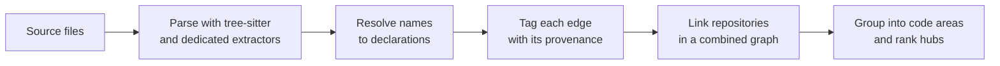

import TryCloudCard from '/snippets/try-cloud-card.mdx';

Graphify finds the dependencies in your code by parsing it, not by asking a model to guess. Every function, class, import and call in the graph comes from reading your source files with a parser, then resolving names to the one declaration they point at. When Graphify can't be sure, it says so on the edge.

This page explains each step, the tags that tell you how sure Graphify is, where a model *is* used, and what the graph can't see.

## The short version

- **No model in the code graph.** Parsing, name resolution and cross-repo linking are deterministic, so the same code gives the same edges.
- **Every edge says where it came from**, so a guess never looks like a fact.
- **A model is used elsewhere**: for documents and images, for naming code areas, and for the wiki and answers. Those are labelled.

## Step 1: Parse the source

The open-source Graphify CLI reads each code file with a [tree-sitter](https://tree-sitter.github.io/tree-sitter/) grammar or one of its built-in parsers. From the file it records the declarations (modules, classes, functions, methods) and the relationships between them, such as `imports`, `calls`, `inherits` and `references`. Each node and edge keeps its source file and line.

- **Hosted Graphify** lists 63 grammars in the app's **Supported grammars** dialog.
- **The open-source Graphify CLI** supports 40 programming languages: 33 through tree-sitter grammars and 7 through built-in parsers.

With the open-source Graphify CLI, most languages work with the default install. SQL, Terraform, R, Erlang, Solidity, OCaml, Common Lisp, VB.NET, DreamMaker and Robot Framework need an optional extra. Install all of them with `pip install "graphifyy[all]"`, or add only the one you need, such as `graphifyy[sql]`. See [supported languages](/open-source/features/languages) for the full list.

With the open-source Graphify CLI, parsing runs on your machine and doesn't need a model or an API key.

## Step 2: Resolve names to declarations

A parser sees that `checkout()` calls `total()`. It doesn't know *which* `total()`. Graphify resolves the name using the evidence in the code: imports, the file it's declared in, and the type of the receiver for `obj.method()` calls.

The rule is conservative. Graphify only draws an edge when the name resolves to exactly one declaration. If two declarations could match, it doesn't pick one. It leaves the edge out, or marks it as ambiguous.

## Step 3: Tag each edge with its provenance

Every edge carries a tag that says how Graphify knows about it. Open-source Graphify writes one of three confidence labels to `graph.json`. Graphify shows the same edges with the Console's tags and line styles.

| Graphify CLI | Console tag | What it means |
| --- | --- | --- |
| `EXTRACTED` | extracted | Read directly from source or the AST, such as a call to a fully qualified name. Highest certainty, drawn solid. |
| `INFERRED` | inferred | Derived by static analysis, such as a method call resolved through a local type. Drawn dashed. |
| `AMBIGUOUS` | synthesized | The evidence doesn't settle on one clear relationship. Lowest certainty, drawn dotted. |
| None | observed | Seen at runtime, in execution or traces. A build from source doesn't produce it. |

An inferred code edge isn't a model's guess: it comes from static resolution. A semantic backend can also infer links between documents and code, which is a separate path. Read [Edges and provenance](/concepts/provenance) for how to use each label.

## Step 4: Link repositories

When you [combine repositories](/platform/graphs#combine-repositories), each repository's nodes keep their own ids. Graphify then adds edges across the boundary in two deterministic passes:

- **Calls across repositories.** If a call's receiver type is declared in another repository, and it resolves to exactly one declaration there, Graphify adds the `calls` edge. An ambiguous name still adds nothing.
- **Shared types.** When two repositories declare a type with the same namespace and name, such as an event contract a producer sends and a consumer handles, Graphify links them with a `same_type_as` edge. It links the nodes rather than merging them, so drifted copies stay visible.

Both passes add edges only. They don't rename or merge nodes. For a walkthrough, see [Map dependencies across multiple repositories](/cookbooks/cross-repo-dependencies).

## Step 5: Group and rank

Graphify groups the graph into code areas with community detection (Leiden, or Louvain as a fallback), based only on how nodes connect. It ranks hub nodes by how many connections they have, leaving out file-level nodes that collect imports mechanically. In the Console, these are the colours on the canvas and the **Most connected** list. The [Graph explorer](/platform/graphs) explains how to read them.

## Where Graphify does use a model

Graphify doesn't use a model to find structure in code. It does use one in these places, and each one is opt-in or labelled:

| Where | What the model does |
| --- | --- |
| Documents, papers, images and transcripts | Extracts concepts and how they relate to the code. This is a separate path from the code parse. With open-source Graphify, it runs through your assistant or a backend you configure, and `--code-only` skips it. |
| Code area names | Gives each code area a readable name. The grouping itself comes from the graph. With open-source Graphify, use `--no-label` to skip it. |
| Duplicate entity tiebreaks | With open-source Graphify's opt-in `--dedup-llm`, settles near-matches the deterministic pass can't decide. |
| Wiki, answers and reviews | Writes wiki articles, answers questions and explains code from the graph. Wiki pages show the model that wrote them, and every statement is marked **Verified**, **Inferred** or **Needs review**. |

See [How Graphify works](/concepts/architecture) for the full pipeline and what each path sends to a provider.

## What the graph can't see

A graph built from source is a map of what the code says, not of what runs. Expect gaps in these places:

- **Dynamic calls.** Calls by string name, reflection, `getattr`, dependency injection and plugin registries often don't resolve to one declaration.
- **External callers.** Code outside the indexed repositories, such as another team's service, a cron job or a public API client, isn't in the graph.
- **Framework wiring.** Routes, decorators and handlers that a framework calls at runtime may show no caller.
- **Optional language extras.** Files in SQL, Terraform, R, Erlang, Solidity, OCaml, Common Lisp, VB.NET, DreamMaker and Robot Framework are parsed only when their extra is installed. Run `pip install "graphifyy[all]"` to cover them.

This is why the Console says "Dynamic and external callers may not be represented" when a check finds no dependents, and why dead code findings ask you to check before you remove anything.

## Next steps

<CardGroup cols={2}>
  <Card title="Edges and provenance" icon="fingerprint" href="/concepts/provenance">
    Read each confidence label.
  </Card>
  <Card title="How Graphify works" icon="network" href="/concepts/architecture">
    The full pipeline, from files to a graph.
  </Card>
  <Card title="Map cross-repo dependencies" icon="git-compare" href="/cookbooks/cross-repo-dependencies">
    Combine repositories into one graph.
  </Card>
  <TryCloudCard />
</CardGroup>

  <a href="/concepts/provenance" rel="prev" className="group inline-flex items-center gap-2 rounded-md border border-[#c7dbd0] dark:border-[#262626] !border-b-[#c7dbd0] dark:!border-b-[#262626] bg-[#ffffff] dark:bg-[#141515] px-3 py-2 text-sm font-medium text-[#062314] dark:text-[#ededed] no-underline transition-colors hover:border-[#94b6a2] dark:hover:border-[#404040] hover:!border-b-[#94b6a2] dark:hover:!border-b-[#404040] hover:bg-[#edf6f0] dark:hover:bg-[#1c1d1d] focus-visible:outline focus-visible:outline-2 focus-visible:outline-offset-4 focus-visible:outline-[#4dea9c]"><svg width="14" height="14" viewBox="0 0 24 24" fill="none" stroke="currentColor" strokeWidth="1.8" aria-hidden="true"><path d="M15 5l-7 7 7 7" /></svg>PreviousEdges and provenance</a>
  <a href="/concepts/outputs" rel="next" className="group inline-flex items-center gap-2 rounded-md border border-[#c7dbd0] dark:border-[#262626] !border-b-[#c7dbd0] dark:!border-b-[#262626] bg-[#ffffff] dark:bg-[#141515] px-3 py-2 text-sm font-medium text-[#062314] dark:text-[#ededed] no-underline transition-colors hover:border-[#94b6a2] dark:hover:border-[#404040] hover:!border-b-[#94b6a2] dark:hover:!border-b-[#404040] hover:bg-[#edf6f0] dark:hover:bg-[#1c1d1d] focus-visible:outline focus-visible:outline-2 focus-visible:outline-offset-4 focus-visible:outline-[#4dea9c] ml-auto">Next<svg width="14" height="14" viewBox="0 0 24 24" fill="none" stroke="currentColor" strokeWidth="1.8" aria-hidden="true"><path d="M9 5l7 7-7 7" /></svg>Graph files and outputs</a>

