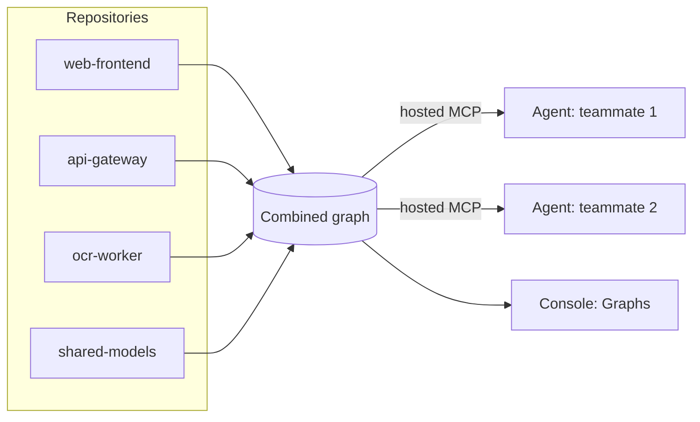

import TryCloudCard from '/snippets/try-cloud-card.mdx';

When your product is split across many repositories, no single checkout shows how they connect. A coding agent asked to change a shared type sees one repository and edits it with confidence, and the break shows up in another repository a day later. This recipe combines your repositories into one cross-repo graph in Graphify, the hosted product, and teaches your agent to check that graph before it changes anything another repository depends on.

## The scenario

A three-person team ships an AI product from 12 repositories: a TypeScript frontend, several Python services, a shared models package, an OCR worker and infrastructure code. Most of the code is written by coding agents, and nobody on the team reads every pull request line by line. Their questions are the same every week:

- "If I rename a field in the shared models package, which services break?"
- "Which repositories call the OCR worker, and through what?"
- "Is anything still using this old endpoint, or can we delete it?"

Each agent session only sees one repository, so each answer is a guess. A combined graph turns them into lookups.

## What you'll build

- One combined graph of your related repositories, with the connections between them.
- A hosted MCP connection that lets every agent on the team query that graph.
- An agent rule that runs a cross-repo impact check before any change to shared code.
- A repeatable prompt for "what breaks if I change X", with results you can verify.



## Setup

- A Graphify account at [app.graphify.com](https://app.graphify.com), connected to GitHub or GitLab. See the [Quickstart](/platform/quickstart).
- Each repository you want to combine added and showing **Indexed** in **Repositories**. See [Repository indexing](/platform/repositories).
- A coding agent that supports remote MCP servers, such as Claude Code, Codex, Cursor or VS Code.

How many repositories you can index, and whether teammates share one workspace graph, depends on your plan. See [plans and pricing](/platform/support/pricing).

## Step 1: Pick the repositories that talk to each other

A combined graph holds two or more indexed repositories from your workspace, up to 100, but bigger isn't better. Start with the repositories that actually import, call or share types with each other. For the team above:

| Combined graph | Repositories | Question it answers |
| --- | --- | --- |
| `product-core` | `web-frontend`, `api-gateway`, `shared-models`, `ocr-worker`, `billing-service` | What breaks when shared code changes |
| `platform` | `infra`, `deploy-scripts`, `api-gateway` | Which services a config change reaches |

A repository can be in more than one combined graph. Leave out repositories that never reference the others, such as a marketing site. They add nodes without adding connections.

## Step 2: Combine the graphs

<Steps>
  <Step title="Open the Combine graphs dialog">
    In the Console sidebar, open **Graphs** > **Cross-Repository** and select **Combine repositories**. You can also select **Combine graph** on **Overview**.
  </Step>
  <Step title="Pick repositories">
    Under **Repositories**, search for and select the repositories from Step 1. Pick from the **Indexed** group. A repository that isn't indexed yet has no graph to combine.
  </Step>
  <Step title="Name it">
    Under **Graph name**, enter a short name you'll type in prompts, such as `product-core`, or leave it blank to use the suggested name. A name is 2 to 120 characters. Select **Combine graph**.
  </Step>
</Steps>

The build moves through `queued`, `running`, then `ready`. When it's ready, the graph is listed under **Combined graphs** in the graph view's right panel. When a member repository re-indexes after a push to its default branch, Graphify rebuilds the combined graph from the new build, so you don't need to recombine by hand.

## Step 3: Read the cross-repo connections

Select the combined graph in the graph selector, or under **Combined graphs** in the right panel. The canvas groups nodes into code areas, and the stats header shows **Nodes**, **Edges** and how each edge was found (**Extracted**, **Inferred**, **Synthesized**, **Observed**). Edges between repositories are drawn in the accent colour. Hover an edge between code areas for a summary, such as `16 cross-community edges · combine · inferred`.

To check one piece of shared code:

1. Search for it in **Search nodes by name, path, or repository** (press `/`), such as the `Invoice` model in `shared-models`. Chips like `kind:function`, `path:src/` and `prov:inferred` narrow the results.
2. In the node details, read the repository, path, code area and connection counts. When the node has edges to other repositories, a **Cross-repo** list shows them above **Outgoing** and **Incoming**.
3. Under **What a change could affect**, choose a **Depth** of 1, 2 or 3 connections. The default is 2. **Possible dependents** shows how many nodes could be affected, and a **Cross-repo dependents** list appears when some of them are in other repositories.
4. Select **Show on canvas** to highlight them on the graph.

<Note>
The impact view is a structural over-estimate. It lists what depends on the node within the depth you chose, not what will break. When it finds nothing, it says **Dynamic and external callers may not be represented**. Use it to decide where to look and which tests to run.
</Note>

To share a view, copy the URL. Selecting a combined graph adds `?group=` and `?title=`. Turning on **Show on canvas** adds `?impact=` and `?depth=`, so a teammate opens the same graph with the same overlay.

## Step 4: Connect your agent to the hosted MCP server

Every agent on the team reads the same combined graph through one server. For Claude Code:

```bash
claude mcp add --transport http --scope user graphify https://api.graphify.com/mcp
```

Start Claude Code, run `/mcp`, select **graphify**, and choose **Authenticate**. For Codex, Cursor, VS Code and other clients, see [Hosted MCP](/platform/hosted-mcp). If the `claude` command isn't available, as in the Claude desktop app, see [Claude Code](/integrations/claude-code).

Check the agent can see the combined graph:

```text
Use Graphify's list_repositories tool and show everything I can query, including combined graphs. If the tool fails, report the error instead of guessing.
```

```text
I can query 13 targets in the acme workspace:
- acme/web-frontend (indexed)
- acme/api-gateway (indexed)
- acme/shared-models (indexed)
...
- product-core (combined graph, 5 repositories)
```

The names and counts are illustrative. If you belong to several workspaces and the combined graph is missing, ask the agent to run `list_workspaces`, then `set_workspace` with the right one.

## Step 5: Ask what breaks across repositories

Name the combined graph in the prompt. A combined graph is targeted by its name, just like a repository.

```text
Using Graphify on the product-core combined graph: I want to rename the
`total_cents` field on the `Invoice` model in shared-models to `amount_cents`.
List every place in other repositories that reads or writes that field or the
Invoice model, grouped by repository, with file paths and line numbers.
Then list the tests linked to those places. Do not edit anything yet.
```

A good answer looks like this (illustrative):

```text
Cross-repo dependents of Invoice.total_cents (product-core):

api-gateway
  - routes/invoices.py:42  serialize_invoice() reads total_cents
  - routes/checkout.py:88  create_checkout() passes total_cents to billing

billing-service
  - billing/charge.py:17   charge_invoice() reads total_cents
  - tests/test_charge.py   covers charge_invoice()

web-frontend
  - src/api/types.ts:12    InvoiceDTO mirrors total_cents (generated type)

No dependents found in ocr-worker.
Suggested order: shared-models -> billing-service -> api-gateway -> web-frontend.
```

Before you trust it, open two or three of the cited lines. Every location should exist and match. If the agent answered without calling a Graphify tool (in Claude Code, look for `graphify` tool calls in the session), it guessed. Ask again and tell it to use Graphify. To make that the default, see [Make your coding agent actually use the graph](/cookbooks/make-agents-use-the-graph).

Other questions that work well on a combined graph:

```text
Which repositories call the OCR worker's process_document task, and through which client code?
```

```text
Is anything in any repository still calling the /v1/upload endpoint in api-gateway? If nothing does, say so and name the evidence.
```

```text
Trace the path from the checkout button in web-frontend to the charge in billing-service, one hop per line.
```

## Step 6: Make the check automatic

Prompts are easy to forget. Put the rule where the agent reads it at the start of every session: `CLAUDE.md` for Claude Code, `AGENTS.md` for Codex and most other agents, or `.cursor/rules/` for Cursor. Commit it to each repository in the combined graph.

```md AGENTS.md
## Cross-repo changes

This repository is part of the `product-core` combined graph in Graphify.

- Before you change a public function, class, API route, message schema or
  shared type, call Graphify on the `product-core` combined graph and list
  its dependents in other repositories.
- If any dependents exist outside this repository, list them in your plan
  and in the pull request description, and stop for approval before editing.
- Cite file paths and lines from the Graphify result. Do not guess dependents
  from names alone.
```

Now a teammate who asks "rename `total_cents`" gets the cross-repo list first, without asking for it.

## When it goes wrong

**The agent says the combined graph doesn't exist.** The build isn't `ready`, or the agent is in another workspace. Check **Combined graphs** in the Console, then run `list_workspaces` and `set_workspace`.

**`query_repository_ambiguous`.** Two repositories share a short name. Use the full name, such as `acme/api`, or the combined graph's name.

**No cross-repo connections appear.** A node only shows a **Cross-repo** list when it has edges to another repository. The repositories may only talk over the network, for example through HTTP calls built from strings or a message queue, with no shared import. Graphify reads structure from code. A URL assembled at runtime isn't a static link. Add the shared client or schema package to the combined graph, since that's where the link usually lives.

**Recent changes are missing.** A member repository's newest default-branch commit isn't indexed yet, and its row in **Repositories** shows **Out of date**. Pushes to other branches don't update the graph. Wait for the index to finish, or select **Reindex** on that repository.

**The build failed.** Select **Retry build**. If the Console shows a limit message, check **Billing**.

**`rate_limited`.** An agent called Graphify in a tight loop. Tell it to reuse results it already has.

## Production patterns

- **One combined graph per question, not per company.** A focused graph of 5 repositories answers faster and with less noise than one of 50.
- **Put the graph name in every repository's agent rules,** so a teammate's agent targets the same graph without being told.
- **Add the dependents list to every cross-repo pull request.** Reviewers then check the repositories the change reaches, not only the one it edits. [Pull request reviews](/platform/reviews) show what each pull request changes.
- **Treat the impact list as a test plan.** Run the tests in every repository the list names before you merge the change in the shared one.
- **Re-check after big moves.** When you split or merge repositories, update the combined graph's members so it matches how the code ships.

## Run it locally instead

Graphify Local can merge graphs on your machine without an account. Build each repository's graph, then add it to the global graph in `~/.graphify/`:

```bash
uv tool install graphifyy
for repo in shared-models billing-service api-gateway; do
  (cd "$repo" && graphify update . && graphify global add graphify-out/graph.json --as "$repo")
done
graphify global list
```

```text
Global graph: /home/you/.graphify/global-graph.json
  shared-models: 412 nodes, added 2026-10-29
  billing-service: 1311 nodes, added 2026-10-29
  api-gateway: 2077 nodes, added 2026-10-29
```

Then query it with `--graph`:

```bash
graphify affected "Invoice" --graph "$(graphify global path)" --depth 2
```

Node IDs are prefixed with the repository tag, so results show which repository each node comes from. The local merge links member calls it can resolve across repositories. An import of a package from another repository can stay unresolved locally, so for full cross-repo connections across a team, use the hosted combined graph. To merge graphs into one file instead, use `graphify merge-graphs`. See [Share a team graph](/cookbooks/shared-team-graph).

## Complete example

The whole loop for one shared-code change, from a fresh agent session:

<Steps>
  <Step title="Confirm the target">
    `Use Graphify's list_repositories tool and confirm product-core is ready.`
  </Step>
  <Step title="Ask for cross-repo dependents">
    `Using Graphify on product-core: what in other repositories depends on Invoice.total_cents? Group by repository, cite files and lines, list linked tests. Do not edit yet.`
  </Step>
  <Step title="Plan the order">
    `Write a change plan that edits shared-models first, then each dependent repository, with one pull request per repository and the tests to run in each.`
  </Step>
  <Step title="Check the work">
    Open two or three cited lines, run the listed tests in every named repository, and paste the dependents list into each pull request description.
  </Step>
</Steps>

## What you built

Your repositories now share one graph. Any agent on the team can ask what a change reaches across repository boundaries, and the rule in each repository makes it ask before it edits shared code.

## Next steps

<CardGroup cols={2}>
  <Card title="Make your agent use the graph" icon="utensils" href="/cookbooks/make-agents-use-the-graph">
    Rules, hooks and a check that your agent calls Graphify.
  </Card>
  <Card title="Graph explorer" icon="book" href="/platform/graphs">
    Combined graph limits, states and the impact view.
  </Card>
  <Card title="Hosted MCP" icon="utensils" href="/platform/hosted-mcp">
    Connect Codex, Cursor, VS Code and other agents.
  </Card>
  <TryCloudCard />
</CardGroup>

<div aria-hidden="true" data-graphify-site-styles="true" className="hidden [body:has(&)_.chat-assistant-floating-input::before]:!bg-transparent [body:has(&)_#footer_a[href*='linkedin.com']_svg]:!bg-[#0a66c2] [body:has(&)_#footer_a[href*='discord.gg']_svg]:!bg-[#5865f2] [body:has(&)_#footer_a[href*='github.com']_svg]:!bg-[#181717] [body:has(&)_#footer_a[href*='x.com']_svg]:!bg-[#000000]" />
