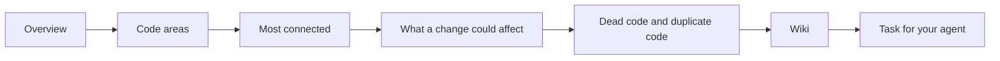

import TryCloudCard from '/snippets/try-cloud-card.mdx';

A code graph with a few thousand nodes looks like a mess the first time you open it. This recipe shows you how to read it in order, from the big picture down to single functions. You'll finish with a short list of dead and duplicate code that your coding agent can check before anything is deleted.

## The scenario

A small team, mostly not engineers, ran their product on 12 repositories that grew one feature at a time. They connected the repositories to Graphify and opened **Graphs**. The graph had about 3,400 nodes, and they didn't know what to do with it.

Every view in this recipe was already in their Console. They just hadn't found it yet. In one session they learned which code areas held the product together, which functions they shouldn't touch casually, and which code nobody was calling.

## What you'll build

- A sense of which code areas your repositories contain and how they connect.
- A short list of the functions most of your code depends on.
- A check of what one change could reach, one to three steps out.
- A list of dead code and duplicate code, with the evidence for each finding.
- A cleanup task your agent investigates before it changes anything.

## Setup

You need a Graphify workspace with at least one indexed repository. If you haven't got one yet, follow the [quickstart](/platform/quickstart). For a graph that spans several repositories, [combine them first](/cookbooks/cross-repo-dependencies).

## Step 1: Start from the overview

Open **Overview**. **Your indexed repositories** lists what Graphify has built. **Workspace stats** and **Graph density** show how big and how connected your graph is. The **Code findings** tile counts what the repository checks found. Select **View all** to open the full list later, in Step 5.

<Tip>
  Read the numbers before you read the picture. A graph of 3,400 nodes is normal for 12 small repositories, so its size is no sign that something is wrong.
</Tip>

## Step 2: Read the code areas

Open **Graphs** and pick a repository. Each colour on the canvas is a code area: a group of files and functions that connect more to each other than to the rest of the code. Open **Graph guide** to see what the colours, lines and highlights mean.

- **Code areas** lists the areas in full screen. Clear **Select all**, then tick one or two areas to see them on their own.
- Select a node, then select its code area in the node details to show only that area on the canvas.
- On very large graphs, the canvas starts in the **Code area view**, which groups nodes into areas until you search for one. A graph this size opens with every node visible.

In the scenario, the team found that most of the 3,400 nodes sat in a few large areas, and that most of the 12 repositories formed areas of their own.

## Step 3: Find what's most connected

**Most connected** lists the nodes with the most connections, along with their count. These are the functions and modules that much of your code depends on. Colours match the code areas, so you can see which area each one belongs to.

Select a row to open its node details. **Connections** shows how many links come in, how many go out, and how many cross into another repository. Select **Explain this code** to ask Graphify what it does, with citations.

<Note>
  A highly connected node isn't a problem in itself. It tells you where a careless change would hurt most, so read it before you clean up around it.
</Note>

## Step 4: Check what a change could affect

In the node details, find **What a change could affect**.

<Steps>
  <Step title="Pick a depth">
    Choose a **Depth** of 1, 2 or 3. Depth 1 shows direct dependents. Depth 2, the default, adds their dependents.
  </Step>
  <Step title="Read the count">
    **Possible dependents** counts what could be affected. **Change with care** marks a node that a lot of code reaches. **Cross-repo dependents** lists the code in other repositories that depends on it.
  </Step>
  <Step title="See it on the canvas">
    Select **Show on canvas** to highlight the affected nodes, then **Clear overlay** when you're done.
  </Step>
</Steps>

If you see **No dependents found in this view**, read the note under it. Graphify only checked the nodes it has loaded, and dynamic and external callers may not be represented. For a deeper check, see [Plan a refactor](/cookbooks/plan-a-refactor).

## Step 5: Find dead code and duplicate code

Select **Code findings** in the graph header, or **View all** on the **Overview** tile. Repository findings come in two kinds.

| Finding | What Graphify checked |
| --- | --- |
| **Dead code** | Private symbols with no references found in at least two indexed builds, spanning 14 days or more. |
| **Duplicate code** | Function bodies that match at this revision, including names, literal values, operators and syntax. |

These checks cover Python, JavaScript and TypeScript. Select a finding, then **What was checked** to see its evidence. **Show in graph** puts it on the canvas.

<Warning>
  Missing references don't prove that code is safe to remove. Before you delete anything, check for dynamic lookups, framework registration, and use from outside the repository. Before you combine duplicates, compare their callers.
</Warning>

If a finding is intentional, use **Hide or give feedback**. **Include findings I hid** brings them back. Read more in [Insights](/platform/insights).

## Step 6: Read the wiki for context

If your workspace has **Wiki**, open it to read about each code area in plain language. **Articles** lists the pages. Each page shows **Key components** and links you back with **Show in graph** or **Open the source**. Every statement is marked **Verified**, **Inferred** or **Needs review**, and pages say which model wrote them, so treat **Inferred** text as a lead to check. Use **Ask the wiki** for questions like "what does this area do?". See [Wiki](/platform/wiki).

## Step 7: Hand the findings to your agent

Open a finding and select **Copy task for my agent**. Use **Preview or edit the task** first if you want to add context. After you copy it, the Console confirms that no code was changed.

The copied task tells your agent not to delete code, apply a change, open a pull request, or merge anything without your separate instruction. It asks the agent to return its investigation and a proposed next step first. Paste it into your agent, read what it finds, and only then approve the change.

For your agent to check callers against the graph while it works, connect it to the [hosted MCP server](/platform/hosted-mcp) and follow [Make your agent use the graph](/cookbooks/make-agents-use-the-graph).

## When it goes wrong

| What you see | What to do |
| --- | --- |
| No **Code findings** | Your repositories may not use Python, JavaScript or TypeScript, or the checks haven't seen two builds 14 days apart yet. |
| A dead code finding that is used | The code may be loaded by name or by a framework. Hide it with **Hide or give feedback** and say why. |
| **No dependents found in this view** for code you know is used | The callers may be dynamic or outside the indexed repositories. Treat the result as incomplete. |
| The canvas is too crowded | Clear **Select all** in **Code areas** and add areas one at a time. |

## What you built

You read your graph from the top down: its code areas, its most connected code, and what one change reaches. You turned the dead and duplicate code findings into a task your agent investigates before it changes anything. To see how sure Graphify is of each connection, read [Provenance](/concepts/provenance).

## Next steps

<CardGroup cols={2}>
  <Card title="Onboard to a codebase" icon="compass" href="/cookbooks/onboard-to-a-codebase">
    Read a new codebase's hubs and ask questions with citations.
  </Card>
  <Card title="Plan a refactor" icon="list-checks" href="/cookbooks/plan-a-refactor">
    List callers and tests before you change a function.
  </Card>
  <Card title="Map cross-repo dependencies" icon="network" href="/cookbooks/cross-repo-dependencies">
    Combine repositories into one graph.
  </Card>
  <TryCloudCard />
</CardGroup>

