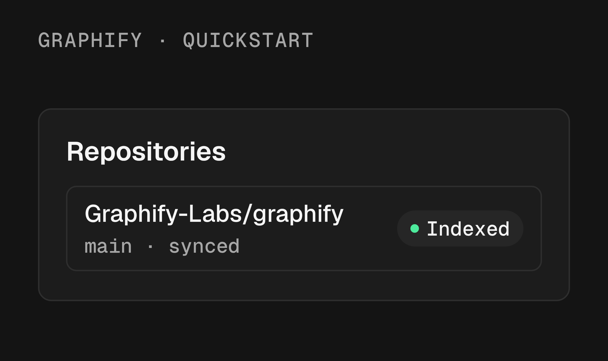
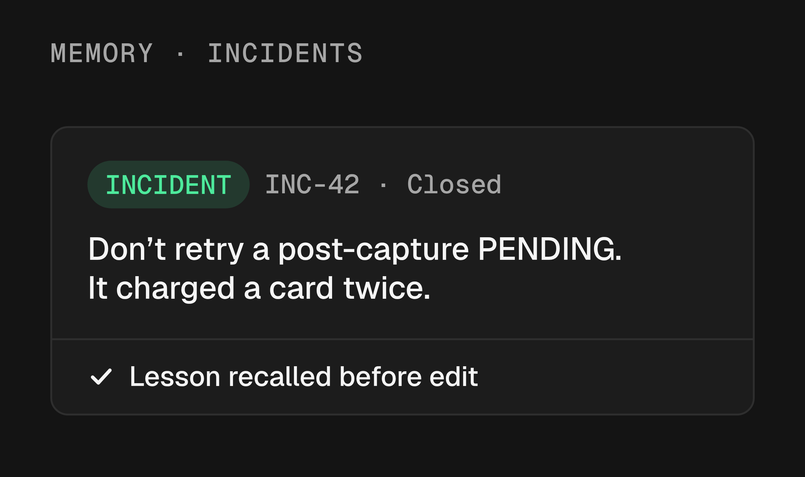
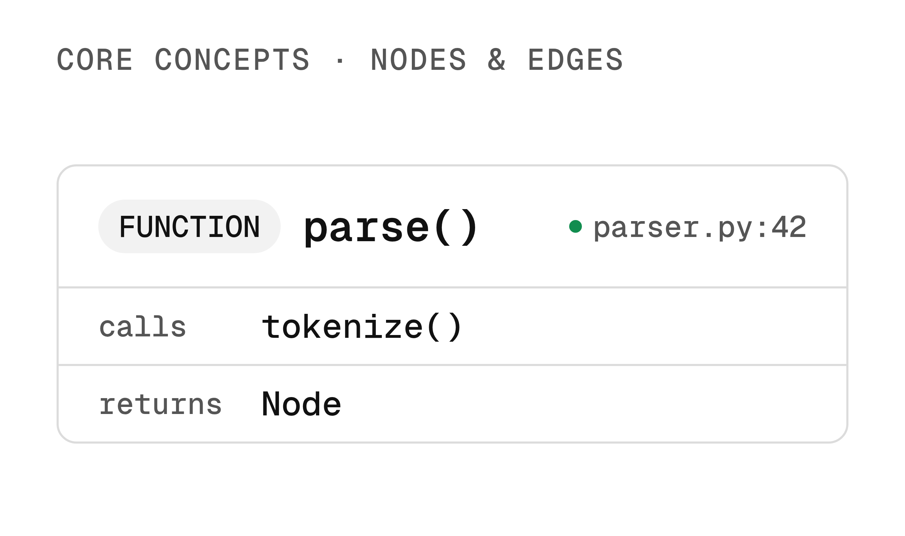
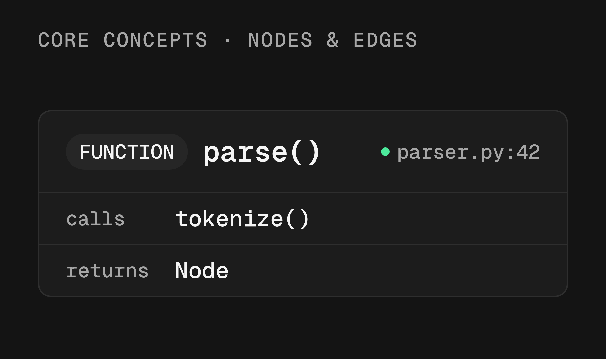
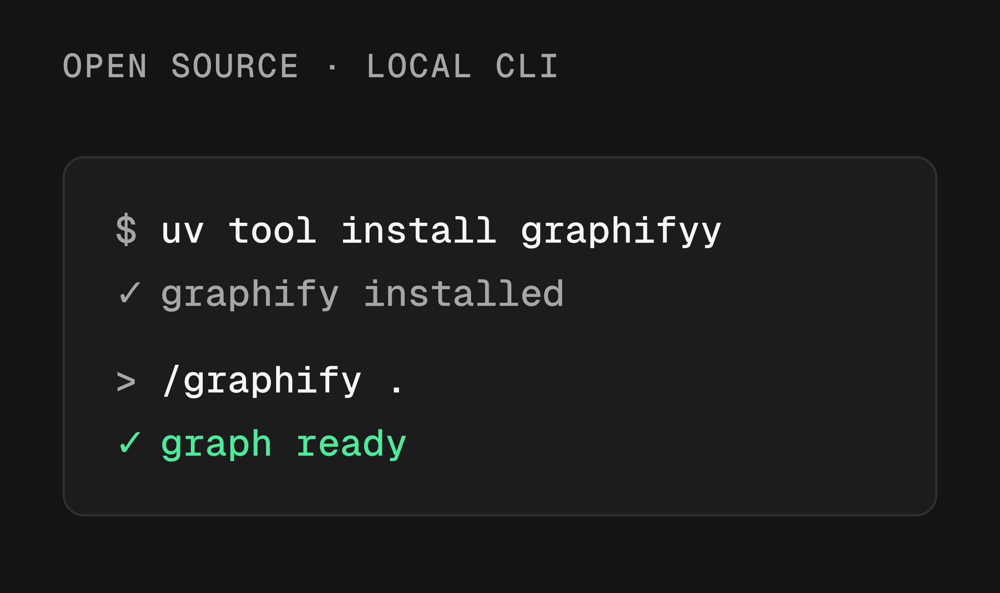

import { HeroInstall, PromptBlock } from '/snippets/hero-install.jsx';

<Visibility for="humans">

</Visibility>

<section aria-labelledby="hero-title" className="not-prose mx-auto grid w-full max-w-6xl items-center gap-10 px-5 text-left text-[#062314] dark:text-[#ededed] md:px-8 gfy-hero-grid" style={{ paddingTop: "clamp(32px, 5vw, 64px)", paddingBottom: 32 }}>
  

    <h1 id="hero-title" className="m-0 text-3xl font-medium leading-[1.1] tracking-[-0.04em] md:text-5xl">Build with Graphify</h1>
    
Graphify is shared codebase context for teams and coding agents. It maps your repositories into a knowledge graph your agents query, and reviews your pull requests with the same graph. Memory and the Wiki keep what your team knows next to the code.

    

      <a href="https://app.graphify.com/signup?utm_source=docs&utm_medium=link&utm_campaign=index&utm_content=hero-start-free" className="inline-flex h-10 items-center rounded-lg px-4 text-sm font-medium no-underline focus-visible:outline focus-visible:outline-2 focus-visible:outline-offset-4 focus-visible:outline-[#4dea9c] bg-[#062314] text-white dark:bg-[#4dea9c] dark:text-[#062314] hover:bg-[#0d3a22] dark:hover:bg-[#7ff0b8] !border-b-0">Start free</a>
      <a href="/platform/quickstart" className="inline-flex h-10 items-center rounded-lg px-4 text-sm font-medium no-underline focus-visible:outline focus-visible:outline-2 focus-visible:outline-offset-4 focus-visible:outline-[#4dea9c] border border-[#c7dbd0] dark:border-[#262626] !border-b-[#c7dbd0] dark:!border-b-[#262626] text-[#254d37] dark:text-[#d4d4d4] hover:bg-[#edf6f0] dark:hover:bg-[#1c1d1d]">Quickstart</a>
      <a href="#set-up-your-coding-agent" className="inline-flex h-10 items-center rounded-lg px-4 text-sm font-medium no-underline focus-visible:outline focus-visible:outline-2 focus-visible:outline-offset-4 focus-visible:outline-[#4dea9c] border border-[#c7dbd0] dark:border-[#262626] !border-b-[#c7dbd0] dark:!border-b-[#262626] text-[#254d37] dark:text-[#d4d4d4] hover:bg-[#edf6f0] dark:hover:bg-[#1c1d1d]">Set up your agent</a>
    

    
Prefer local? <a href="/open-source/quickstart" className="gfy-link">Graphify CLI</a>

  

  

<HeroInstall />
    
The hosted MCP server signs you in with OAuth. No API key needed. Other agents: <a href="/integrations/overview" className="gfy-link">Integrations</a>.

  

</section>

<section id="set-up-your-coding-agent" aria-labelledby="agent-setup-title" className="not-prose mx-auto w-full max-w-6xl px-5 pb-10 text-left text-[#062314] dark:text-[#ededed] md:px-8">
  

    

      <h2 id="agent-setup-title" className="m-0 text-xl font-medium tracking-[-0.02em]">Set up your coding agent with one prompt</h2>
      
Paste this into Claude Code, Codex, Cursor, or any coding agent. It reads the <a href="/for-agents">agent setup playbook</a>, connects the hosted MCP server, and checks the connection.

    

    

      <PromptBlock text="Set up Graphify for me. Fetch https://docs.graphify.com/for-agents.md and follow it." />
    

  

</section>

<section aria-labelledby="graphify-for-agents-title" className="not-prose mx-auto w-full max-w-6xl px-5 pb-10 text-left text-[#062314] dark:text-[#ededed] md:px-8">
  

    
<h2 id="graphify-for-agents-title" className="m-0 text-xl font-medium tracking-[-0.02em]">Graphify for agents</h2><a href="/agents/overview" className="text-sm font-medium text-[#254d37] dark:text-[#d4d4d4] no-underline !border-b-0 hover:underline">How agents use Graphify →</a>

    <ul className="m-0 mt-3 list-none divide-y divide-[#d6e5dc] dark:divide-[#262626] p-0">
<li className="grid gap-1 py-3 sm:grid-cols-[180px_1fr_auto] sm:items-center sm:gap-4">Graphify MCPAdd https://api.graphify.com/mcp to any MCP client. Sign in with OAuth, no API key.<a href="/platform/graphify-mcp" className="text-sm font-medium text-[#118d4f] dark:text-[#4dea9c] no-underline !border-b-0 hover:underline">Graphify MCP →</a></li>
<li className="grid gap-1 py-3 sm:grid-cols-[180px_1fr_auto] sm:items-center sm:gap-4">Plugins and one-click installsInstall <a href="/integrations/claude-ai">from the Claude directory</a>, the <a href="/integrations/cursor">Cursor plugin</a>, the VS Code extension, or the Graphify plugin for ChatGPT and Codex.<a href="/integrations/overview" className="text-sm font-medium text-[#118d4f] dark:text-[#4dea9c] no-underline !border-b-0 hover:underline">Integrations →</a></li>
<li className="grid gap-1 py-3 sm:grid-cols-[180px_1fr_auto] sm:items-center sm:gap-4">Cross-repo PR reviewGraphify reviews each new pull request with the graph, not only the diff. Your agent reads the result with <code>review_status</code>.<a href="/platform/reviews" className="text-sm font-medium text-[#118d4f] dark:text-[#4dea9c] no-underline !border-b-0 hover:underline">Pull request reviews →</a></li>
<li className="grid gap-1 py-3 sm:grid-cols-[180px_1fr_auto] sm:items-center sm:gap-4">Shared memoryYour team's decisions, incidents and lessons, tied to the code. Agents check them with <code>recall</code> before they edit and save new notes with <code>remember</code>.<a href="/platform/memory" className="text-sm font-medium text-[#118d4f] dark:text-[#4dea9c] no-underline !border-b-0 hover:underline">Memory →</a></li>
    </ul>
  

</section>

<section className="not-prose mx-auto w-full max-w-6xl px-5 pb-10 text-left text-[#062314] dark:text-[#ededed] md:px-8">
  
<a href="/platform/quickstart" className="group flex flex-col overflow-hidden rounded-xl border border-[#d6e5dc] dark:border-[#262626] bg-[#ffffff] dark:bg-[#141515] text-[#062314] dark:text-[#ededed] no-underline transition-colors hover:border-[#94b6a2] dark:hover:border-[#404040] focus-visible:outline focus-visible:outline-2 focus-visible:outline-offset-4 focus-visible:outline-[#4dea9c] !border-b-[#d6e5dc] dark:!border-b-[#262626] hover:!border-b-[#94b6a2] dark:hover:!border-b-[#404040]">

<h3 className="m-0 text-lg font-medium tracking-[-0.02em]">Start with Graphify</h3>
The hosted version of Graphify. Sign in, index a GitHub repository from your browser, and explore its graph in minutes.
Quickstart<svg width="16" height="16" viewBox="0 0 24 24" fill="none" stroke="currentColor" strokeWidth="1.6" aria-hidden="true"><path d="M7 17 17 7M7 7h10v10" /></svg>
</a><a href="/integrations/overview" className="group flex flex-col overflow-hidden rounded-xl border border-[#d6e5dc] dark:border-[#262626] bg-[#ffffff] dark:bg-[#141515] text-[#062314] dark:text-[#ededed] no-underline transition-colors hover:border-[#94b6a2] dark:hover:border-[#404040] focus-visible:outline focus-visible:outline-2 focus-visible:outline-offset-4 focus-visible:outline-[#4dea9c] !border-b-[#d6e5dc] dark:!border-b-[#262626] hover:!border-b-[#94b6a2] dark:hover:!border-b-[#404040]">

<h3 className="m-0 text-lg font-medium tracking-[-0.02em]">Connect your coding agent</h3>
Point Claude Code, Codex, Cursor, and other agents at the hosted MCP server. They sign in with OAuth, so there is no API key to paste.
Hosted MCP setup<svg width="16" height="16" viewBox="0 0 24 24" fill="none" stroke="currentColor" strokeWidth="1.6" aria-hidden="true"><path d="M7 17 17 7M7 7h10v10" /></svg>
</a><a href="/cookbooks/remember-incident-lessons" className="group flex flex-col overflow-hidden rounded-xl border border-[#d6e5dc] dark:border-[#262626] bg-[#ffffff] dark:bg-[#141515] text-[#062314] dark:text-[#ededed] no-underline transition-colors hover:border-[#94b6a2] dark:hover:border-[#404040] focus-visible:outline focus-visible:outline-2 focus-visible:outline-offset-4 focus-visible:outline-[#4dea9c] !border-b-[#d6e5dc] dark:!border-b-[#262626] hover:!border-b-[#94b6a2] dark:hover:!border-b-[#404040]">

<h3 className="m-0 text-lg font-medium tracking-[-0.02em]">Remember incident lessons</h3>
Save what broke and why in Memory, tied to the code. Your agents recall it before they edit that function or review a related pull request.
Incident memory<svg width="16" height="16" viewBox="0 0 24 24" fill="none" stroke="currentColor" strokeWidth="1.6" aria-hidden="true"><path d="M7 17 17 7M7 7h10v10" /></svg>
</a><a href="/cookbooks/shared-team-graph" className="group flex flex-col overflow-hidden rounded-xl border border-[#d6e5dc] dark:border-[#262626] bg-[#ffffff] dark:bg-[#141515] text-[#062314] dark:text-[#ededed] no-underline transition-colors hover:border-[#94b6a2] dark:hover:border-[#404040] focus-visible:outline focus-visible:outline-2 focus-visible:outline-offset-4 focus-visible:outline-[#4dea9c] !border-b-[#d6e5dc] dark:!border-b-[#262626] hover:!border-b-[#94b6a2] dark:hover:!border-b-[#404040]">

<h3 className="m-0 text-lg font-medium tracking-[-0.02em]">Keep your team in sync</h3>
Refresh graph context on every commit and investigate changes across pull requests.
Team workflows<svg width="16" height="16" viewBox="0 0 24 24" fill="none" stroke="currentColor" strokeWidth="1.6" aria-hidden="true"><path d="M7 17 17 7M7 7h10v10" /></svg>
</a><a href="/concepts/architecture" className="group flex flex-col overflow-hidden rounded-xl border border-[#d6e5dc] dark:border-[#262626] bg-[#ffffff] dark:bg-[#141515] text-[#062314] dark:text-[#ededed] no-underline transition-colors hover:border-[#94b6a2] dark:hover:border-[#404040] focus-visible:outline focus-visible:outline-2 focus-visible:outline-offset-4 focus-visible:outline-[#4dea9c] !border-b-[#d6e5dc] dark:!border-b-[#262626] hover:!border-b-[#94b6a2] dark:hover:!border-b-[#404040]">

<h3 className="m-0 text-lg font-medium tracking-[-0.02em]">Understand the graph</h3>
How Graphify turns source files into nodes, edges, and provenance your assistant can traverse.
Core concepts<svg width="16" height="16" viewBox="0 0 24 24" fill="none" stroke="currentColor" strokeWidth="1.6" aria-hidden="true"><path d="M7 17 17 7M7 7h10v10" /></svg>
</a><a href="/open-source/quickstart" className="group flex flex-col overflow-hidden rounded-xl border border-[#d6e5dc] dark:border-[#262626] bg-[#ffffff] dark:bg-[#141515] text-[#062314] dark:text-[#ededed] no-underline transition-colors hover:border-[#94b6a2] dark:hover:border-[#404040] focus-visible:outline focus-visible:outline-2 focus-visible:outline-offset-4 focus-visible:outline-[#4dea9c] !border-b-[#d6e5dc] dark:!border-b-[#262626] hover:!border-b-[#94b6a2] dark:hover:!border-b-[#404040]">

<h3 className="m-0 text-lg font-medium tracking-[-0.02em]">Graphify CLI</h3>
Run open-source Graphify, the graphifyy package, on your machine. Map a repository from your terminal and keep the graph in your own files.
Local quickstart<svg width="16" height="16" viewBox="0 0 24 24" fill="none" stroke="currentColor" strokeWidth="1.6" aria-hidden="true"><path d="M7 17 17 7M7 7h10v10" /></svg>
</a>

</section>

<section aria-labelledby="features-title" className="mx-auto w-full max-w-6xl px-5 pb-6 text-left md:px-8">
  <h2 id="features-title" className="m-0 text-xl font-medium tracking-[-0.02em] text-[#062314] dark:text-[#ededed]">Features</h2>
  <CardGroup cols={3}>
    <Card title="Ask" icon="message-square-text" href="/platform/ask">
      Ask a repository a question and get an answer that cites the graph.
    </Card>
    <Card title="Reviews" icon="git-pull-request" href="/platform/reviews">
      Review each pull request with the code it can affect.
    </Card>
    <Card title="Memory" icon="brain" href="/platform/memory">
      Keep decisions, incidents and lessons tied to the code.
    </Card>
    <Card title="Wiki" icon="book-open" href="/platform/wiki">
      Read generated docs for every indexed repository.
    </Card>
    <Card title="MCP" icon="plug" href="/platform/graphify-mcp">
      Connect your coding agent to the hosted graph with OAuth.
    </Card>
    <Card title="CLI" icon="square-terminal" href="/open-source/configuration/cli">
      Build and query a graph on your own machine.
    </Card>
  </CardGroup>
</section>

<section className="not-prose mx-auto w-full max-w-6xl px-5 pb-16 text-left text-[#062314] dark:text-[#ededed] md:px-8">
  

<h2 className="m-0 text-base font-medium">Connect your agent to Graphify</h2>
One hosted MCP server, <code>https://api.graphify.com/mcp</code>. Prefer the terminal? See the <a href="/open-source/configuration/cli">CLI reference</a>.

<a href="/integrations/vscode" className="inline-flex h-10 items-center rounded-lg border border-[#c7dbd0] dark:border-[#262626] px-4 text-[#254d37] dark:text-[#d4d4d4] no-underline hover:bg-[#edf6f0] dark:hover:bg-[#1c1d1d] !border-b-[#c7dbd0] dark:!border-b-[#262626]">VS Code →</a><a href="/integrations/chatgpt" className="inline-flex h-10 items-center rounded-lg border border-[#c7dbd0] dark:border-[#262626] px-4 text-[#254d37] dark:text-[#d4d4d4] no-underline hover:bg-[#edf6f0] dark:hover:bg-[#1c1d1d] !border-b-[#c7dbd0] dark:!border-b-[#262626]">ChatGPT and Codex →</a><a href="/integrations/other-agents" className="inline-flex h-10 items-center rounded-lg border border-[#c7dbd0] dark:border-[#262626] px-4 text-[#254d37] dark:text-[#d4d4d4] no-underline hover:bg-[#edf6f0] dark:hover:bg-[#1c1d1d] !border-b-[#c7dbd0] dark:!border-b-[#262626]">Other agents →</a>

  
Graphify Labs · The knowledge graph control plane and shared context of codebases for agents and developers.
<a href="https://github.com/Graphify-Labs" className="no-underline !border-b-0">GitHub ↗</a><a href="https://discord.gg/graphify" className="no-underline !border-b-0">Community ↗</a><a href="https://graphify.com?utm_source=docs&utm_medium=link&utm_campaign=index" className="no-underline !border-b-0">graphify.com ↗</a>

</section>
