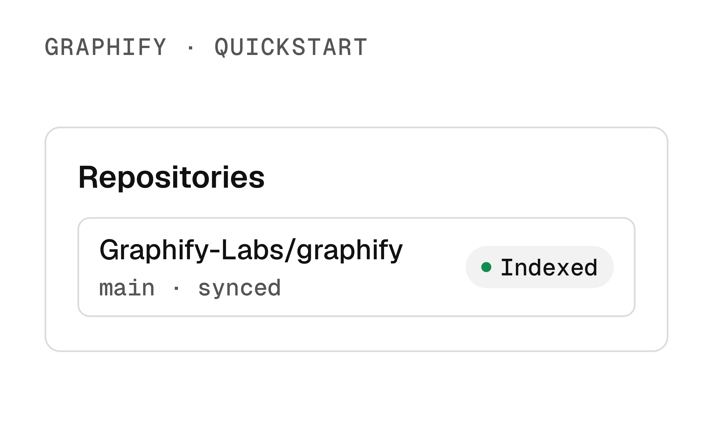
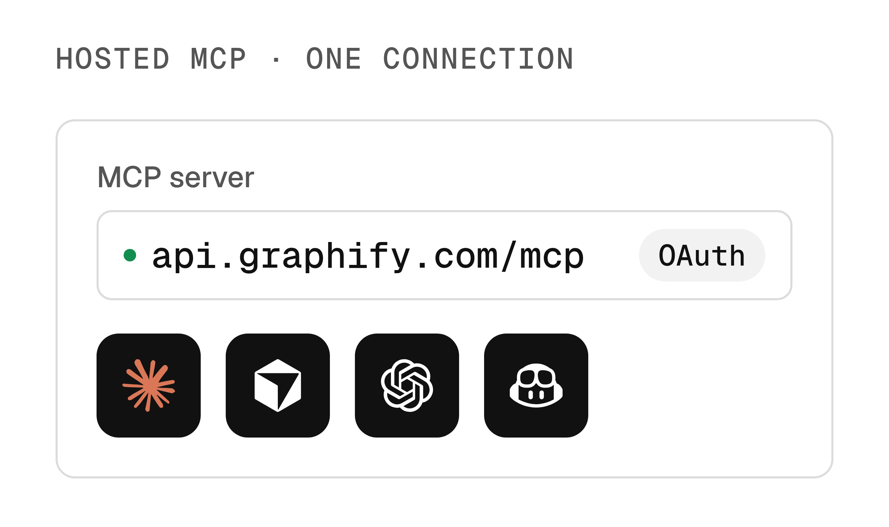
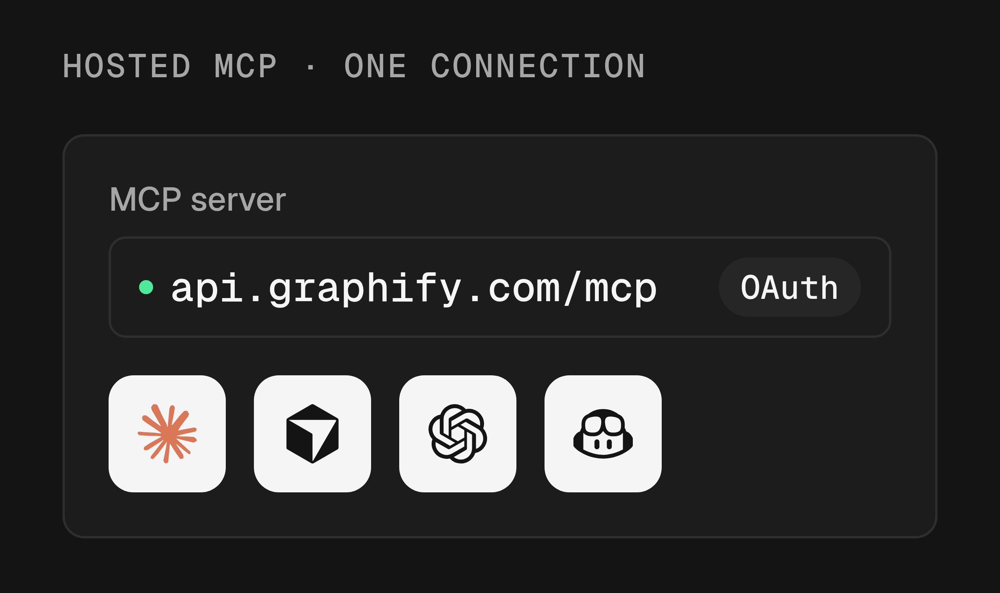
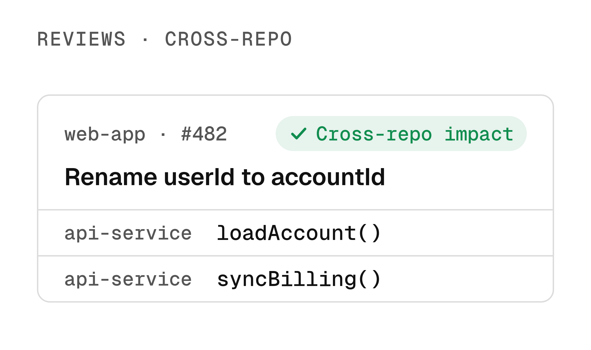
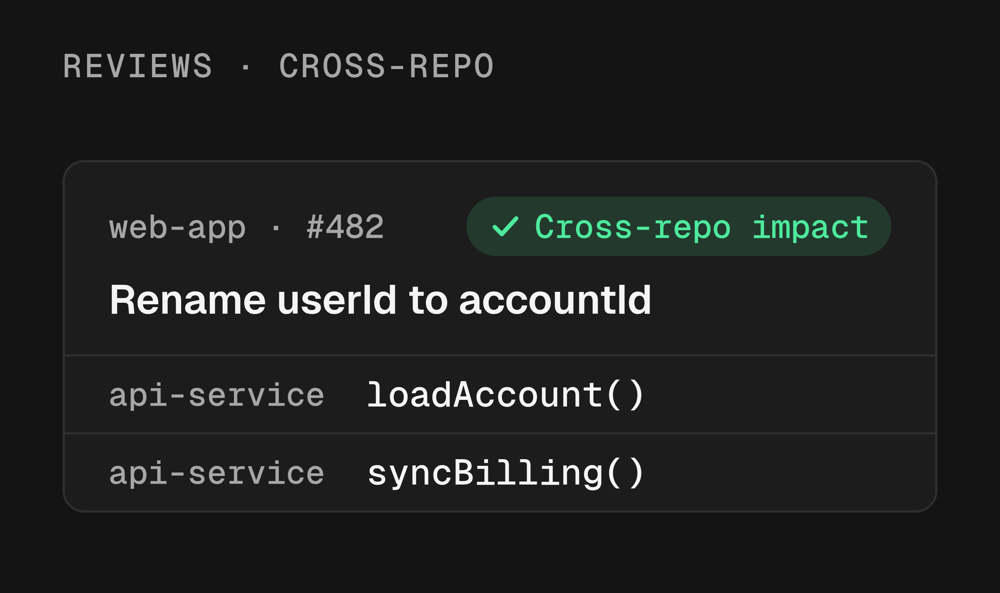
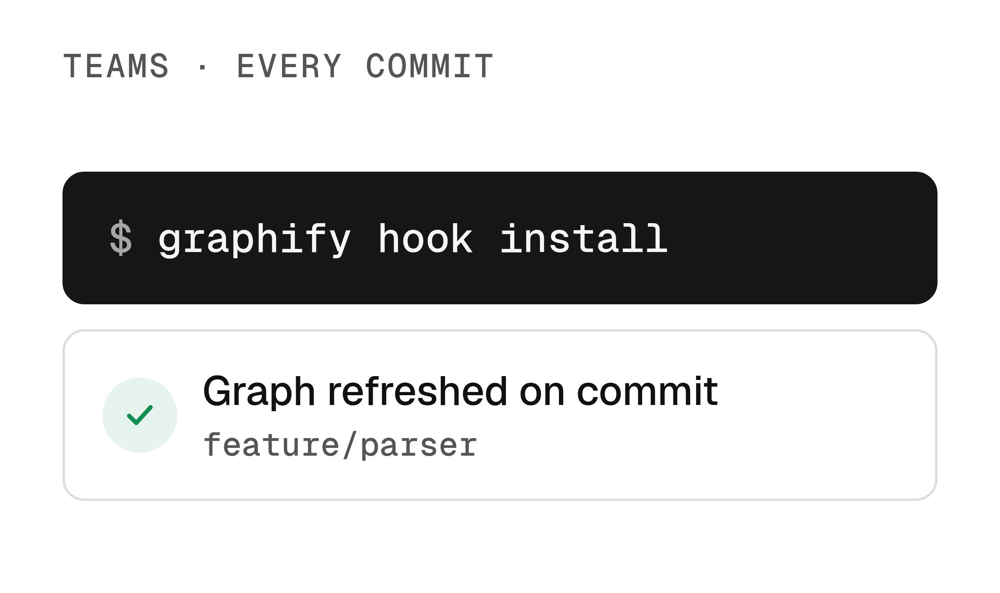
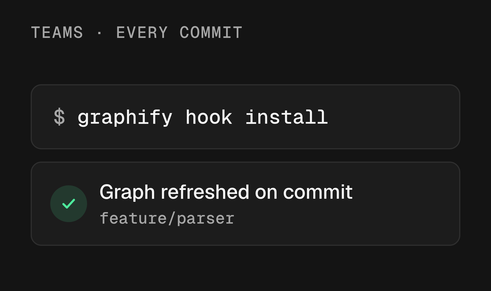
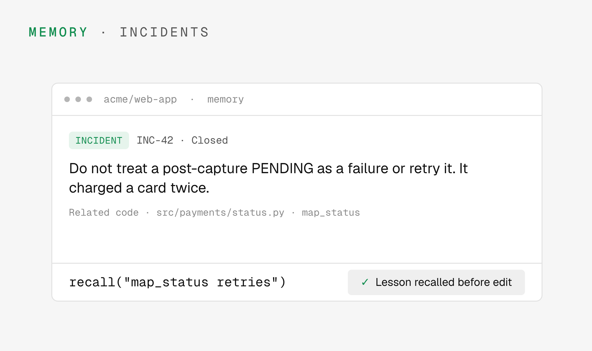
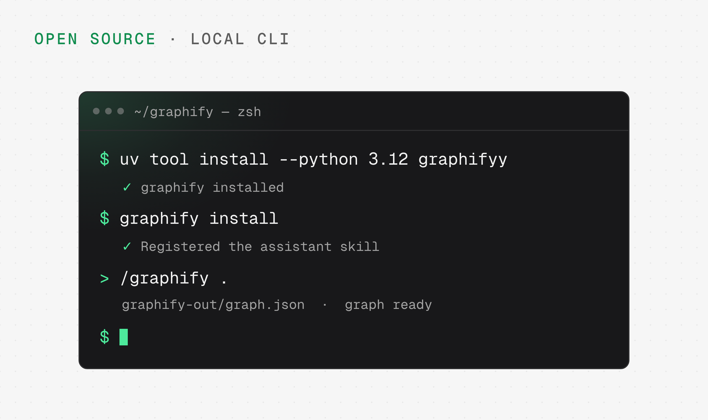

import { HeroInstall } from '/snippets/hero-install.jsx';

<Visibility for="agents">

Connect a coding agent to the hosted MCP server at `https://api.graphify.com/mcp`. Sign-in is OAuth. There is no API key.

- Claude Code: `claude mcp add --transport http graphify https://api.graphify.com/mcp`
- Cursor: `/add-plugin graphify`
- Codex: `codex mcp add graphify --url https://api.graphify.com/mcp && codex mcp login graphify`

Other agents are on [Integrations](/integrations/overview).

</Visibility>

<Visibility for="humans">

<section aria-labelledby="hero-title" className="not-prose mx-auto grid w-full max-w-6xl items-center gap-10 px-5 text-left text-[#171717] dark:text-[#ededed] md:px-8 gfy-hero-grid" style={{ paddingTop: "clamp(32px, 5vw, 64px)", paddingBottom: 32 }}>
  

    <h1 id="hero-title" className="m-0 text-3xl font-semibold leading-[1.1] tracking-[-0.04em] md:text-5xl">Build with Graphify</h1>
    
Graphify is shared codebase context for teams and coding agents. It maps your repositories into a knowledge graph your agents query, and reviews your pull requests with the same graph. Memory and the Wiki keep what your team knows next to the code.

    

      <a href="https://app.graphify.com/signup?utm_source=docs&utm_medium=link&utm_campaign=index&utm_content=hero-start-free" className="inline-flex h-10 items-center rounded-lg px-4 text-sm font-medium no-underline focus-visible:outline focus-visible:outline-2 focus-visible:outline-offset-4 focus-visible:outline-[#737373] bg-[#0e7a43] text-white hover:bg-[#0b6337] !border-b-0">Start free</a>
      <a href="/platform/quickstart" className="inline-flex h-10 items-center rounded-lg px-4 text-sm font-medium no-underline focus-visible:outline focus-visible:outline-2 focus-visible:outline-offset-4 focus-visible:outline-[#737373] border border-[#d4d4d4] dark:border-[#262626] !border-b-[#d4d4d4] dark:!border-b-[#262626] text-[#262626] dark:text-[#d4d4d4] hover:bg-[#f5f5f5] dark:hover:bg-[#1c1d1d]">Quickstart</a>
    

    
Prefer local? <a href="/open-source/quickstart" className="gfy-link">Graphify CLI</a>

  

  

    <HeroInstall />
  

</section>

<section id="set-up-your-coding-agent" aria-labelledby="agent-setup-title" className="not-prose mx-auto w-full max-w-6xl px-5 pb-10 text-left text-[#171717] dark:text-[#ededed] md:px-8">
  

    

      <h2 id="agent-setup-title" className="m-0 text-xl font-semibold tracking-[-0.02em]">Add the hosted MCP server</h2>
      
Choose your coding agent and copy its command. The hosted MCP server signs you in with OAuth. No API key needed. Other agents are on <a href="/integrations/overview" className="gfy-link">Integrations</a>.

    

    

      <HeroInstall mode="mcp" />
    

  

</section>

<section className="not-prose mx-auto w-full max-w-6xl px-5 pb-10 text-left text-[#171717] dark:text-[#ededed] md:px-8">
  
<a href="/platform/quickstart" className="group flex flex-col overflow-hidden rounded-xl border border-[#e5e5e5] dark:border-[#262626] bg-[#ffffff] dark:bg-[#141515] text-[#171717] dark:text-[#ededed] no-underline transition-colors hover:border-[#a3a3a3] dark:hover:border-[#404040] focus-visible:outline focus-visible:outline-2 focus-visible:outline-offset-4 focus-visible:outline-[#737373] !border-b-[#e5e5e5] dark:!border-b-[#262626] hover:!border-b-[#a3a3a3] dark:hover:!border-b-[#404040]">

<h3 className="m-0 text-lg font-semibold tracking-[-0.02em]">Start with Graphify</h3>
The hosted version of Graphify. Sign in, index a GitHub repository from your browser, and explore its graph in minutes.
Quickstart<svg width="16" height="16" viewBox="0 0 24 24" fill="none" stroke="currentColor" strokeWidth="1.6" aria-hidden="true"><path d="M7 17 17 7M7 7h10v10" /></svg>
</a><a href="/integrations/overview" className="group flex flex-col overflow-hidden rounded-xl border border-[#e5e5e5] dark:border-[#262626] bg-[#ffffff] dark:bg-[#141515] text-[#171717] dark:text-[#ededed] no-underline transition-colors hover:border-[#a3a3a3] dark:hover:border-[#404040] focus-visible:outline focus-visible:outline-2 focus-visible:outline-offset-4 focus-visible:outline-[#737373] !border-b-[#e5e5e5] dark:!border-b-[#262626] hover:!border-b-[#a3a3a3] dark:hover:!border-b-[#404040]">

<h3 className="m-0 text-lg font-semibold tracking-[-0.02em]">Connect your coding agent</h3>
Point Claude Code, Codex, Cursor, and other agents at the hosted MCP server. They sign in with OAuth, so there is no API key to paste.
Hosted MCP setup<svg width="16" height="16" viewBox="0 0 24 24" fill="none" stroke="currentColor" strokeWidth="1.6" aria-hidden="true"><path d="M7 17 17 7M7 7h10v10" /></svg>
</a><a href="/platform/reviews#cross-repo-pull-request-reviews" className="group flex flex-col overflow-hidden rounded-xl border border-[#e5e5e5] dark:border-[#262626] bg-[#ffffff] dark:bg-[#141515] text-[#171717] dark:text-[#ededed] no-underline transition-colors hover:border-[#a3a3a3] dark:hover:border-[#404040] focus-visible:outline focus-visible:outline-2 focus-visible:outline-offset-4 focus-visible:outline-[#737373] !border-b-[#e5e5e5] dark:!border-b-[#262626] hover:!border-b-[#a3a3a3] dark:hover:!border-b-[#404040]">

<h3 className="m-0 text-lg font-semibold tracking-[-0.02em]">Cross-repo PR review</h3>
Combine your repositories and every pull request review checks the code it affects in the others, so a breaking change shows up before you merge.
Pull request reviews<svg width="16" height="16" viewBox="0 0 24 24" fill="none" stroke="currentColor" strokeWidth="1.6" aria-hidden="true"><path d="M7 17 17 7M7 7h10v10" /></svg>
</a><a href="/cookbooks/shared-team-graph" className="group flex flex-col overflow-hidden rounded-xl border border-[#e5e5e5] dark:border-[#262626] bg-[#ffffff] dark:bg-[#141515] text-[#171717] dark:text-[#ededed] no-underline transition-colors hover:border-[#a3a3a3] dark:hover:border-[#404040] focus-visible:outline focus-visible:outline-2 focus-visible:outline-offset-4 focus-visible:outline-[#737373] !border-b-[#e5e5e5] dark:!border-b-[#262626] hover:!border-b-[#a3a3a3] dark:hover:!border-b-[#404040]">

<h3 className="m-0 text-lg font-semibold tracking-[-0.02em]">Keep your team in sync</h3>
Refresh graph context on every commit and investigate changes across pull requests.
Team workflows<svg width="16" height="16" viewBox="0 0 24 24" fill="none" stroke="currentColor" strokeWidth="1.6" aria-hidden="true"><path d="M7 17 17 7M7 7h10v10" /></svg>
</a><a href="/cookbooks/remember-incident-lessons" className="group flex flex-col overflow-hidden rounded-xl border border-[#e5e5e5] dark:border-[#262626] bg-[#ffffff] dark:bg-[#141515] text-[#171717] dark:text-[#ededed] no-underline transition-colors hover:border-[#a3a3a3] dark:hover:border-[#404040] focus-visible:outline focus-visible:outline-2 focus-visible:outline-offset-4 focus-visible:outline-[#737373] !border-b-[#e5e5e5] dark:!border-b-[#262626] hover:!border-b-[#a3a3a3] dark:hover:!border-b-[#404040]">

<h3 className="m-0 text-lg font-semibold tracking-[-0.02em]">Remember incident lessons</h3>
Save what broke and why in Memory, tied to the code. Your agents recall it before they edit that function or review a related pull request.
Incident memory<svg width="16" height="16" viewBox="0 0 24 24" fill="none" stroke="currentColor" strokeWidth="1.6" aria-hidden="true"><path d="M7 17 17 7M7 7h10v10" /></svg>
</a><a href="/open-source/quickstart" className="group flex flex-col overflow-hidden rounded-xl border border-[#e5e5e5] dark:border-[#262626] bg-[#ffffff] dark:bg-[#141515] text-[#171717] dark:text-[#ededed] no-underline transition-colors hover:border-[#a3a3a3] dark:hover:border-[#404040] focus-visible:outline focus-visible:outline-2 focus-visible:outline-offset-4 focus-visible:outline-[#737373] !border-b-[#e5e5e5] dark:!border-b-[#262626] hover:!border-b-[#a3a3a3] dark:hover:!border-b-[#404040]">

<h3 className="m-0 text-lg font-semibold tracking-[-0.02em]">Graphify CLI</h3>
Run open-source Graphify, the graphifyy package, on your machine. Map a repository from your terminal and keep the graph in your own files.
Local quickstart<svg width="16" height="16" viewBox="0 0 24 24" fill="none" stroke="currentColor" strokeWidth="1.6" aria-hidden="true"><path d="M7 17 17 7M7 7h10v10" /></svg>
</a>

</section>
</Visibility>
