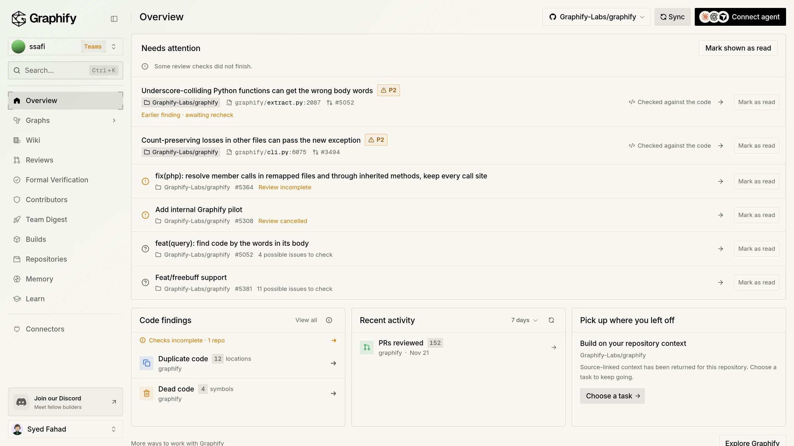
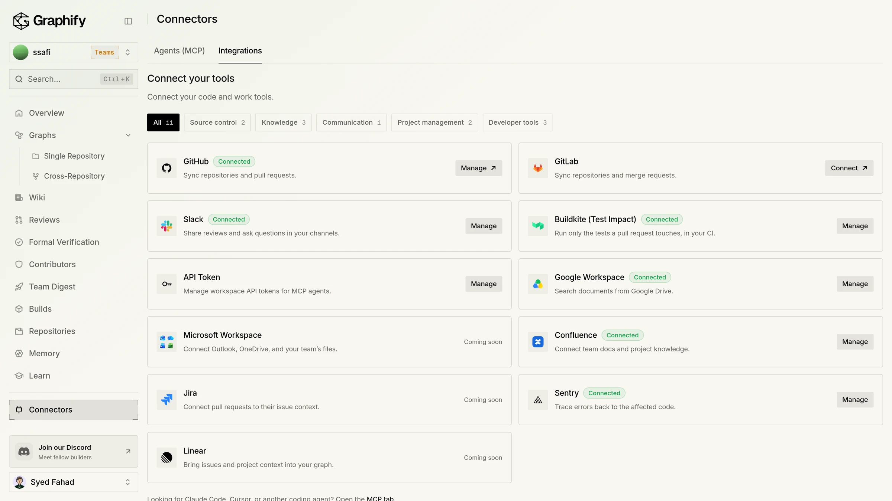
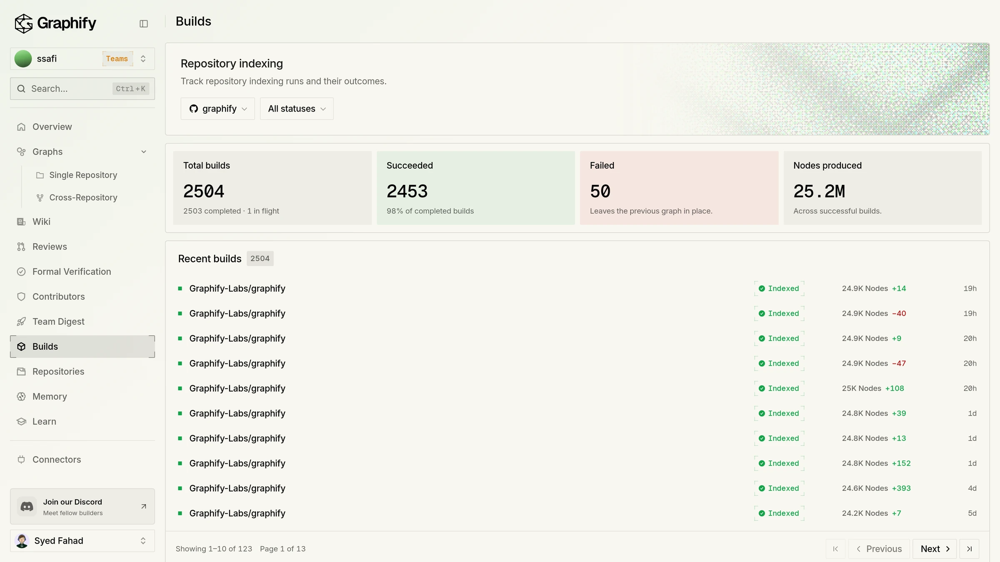
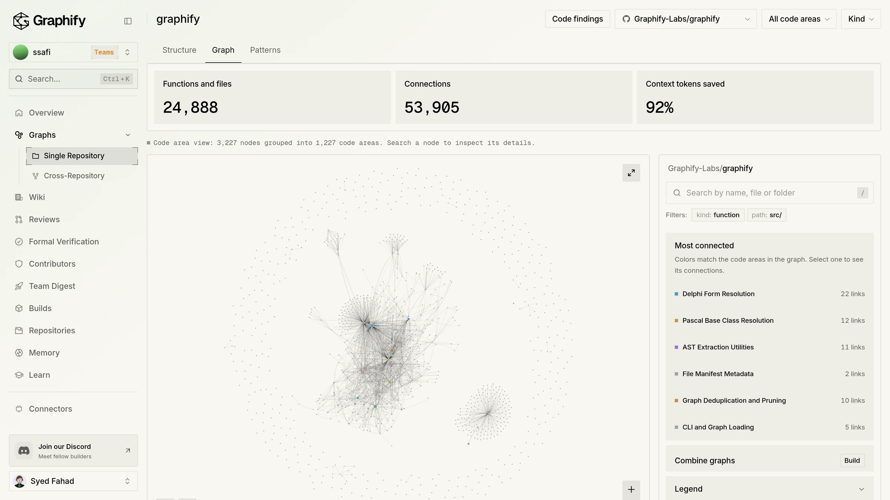
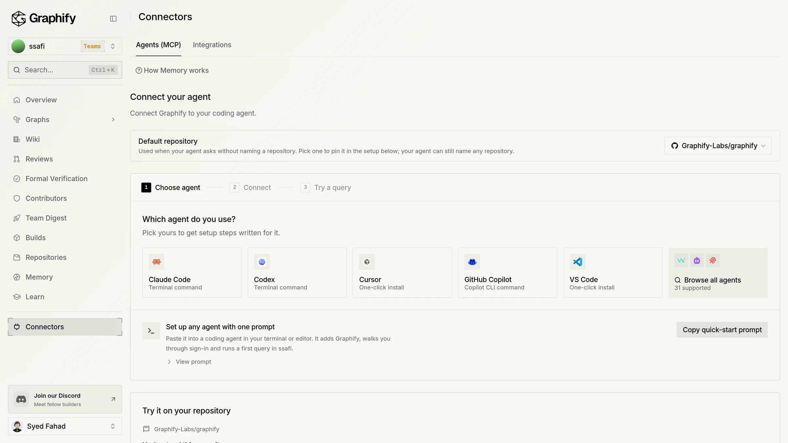

このページでは、app.graphify.com で提供しているホスト型プロダクトの Graphify を使い始める手順を説明します。運用は私たちが行うため、デプロイするものは何もありません。Graphify は GitHub リポジトリをインデックス化し、リポジトリごとにグラフと Wiki を構築して、ホスト型 MCP サーバー経由でコーディングエージェントに提供します。お使いのマシンにインストールするものもありません。

必要なのは、対象リポジトリにアクセスできる GitHub アカウントと、MCP に対応したコーディングエージェントです。Graphify アカウントも必要です。まだお持ちでない場合は、接続時に無料で作成するか、下の手順でサインインしてください。Free プランはカード登録不要です。[プランと料金](/platform/support/pricing)を参照してください。グラフを自分のマシン上に置きたい場合は、オープンソース版 Graphify（`graphifyy` パッケージ）を[ローカル版クイックスタート](/open-source/quickstart)に沿って使ってください。

<Note>
あなたがエージェントの場合は、以下の手順に進む前に[エージェント向けの注意事項](/for-agents)を読んでください。
</Note>

<Steps>
  <Step title="サインインする" titleSize="h2">
    Web UI であるコンソール（[app.graphify.com](https://app.graphify.com?utm_source=docs&utm_medium=link&utm_campaign=platform-quickstart)）を開いてサインインします。**Overview** が表示されます。**What would you like to do first?** と聞かれることがあります。選択肢を選んでもスキップしてもかまいません。以下の手順で同じ内容を扱います。

    
  </Step>
  <Step title="GitHub を接続する" titleSize="h2">
    **Repositories** に移動して **Add GitHub repositories** をクリックし、使いたいリポジトリへのアクセスを Graphify GitHub App に許可します。**Connectors → Integrations** から接続することもできます。

    接続したリポジトリは **Paused** と **Not indexed** と表示されます。自分で選ぶまで何もインデックス化されないため、これは想定どおりの状態です。

    
  </Step>
  <Step title="リポジトリをインデックス化する" titleSize="h2">
    リポジトリを見つけて **…** メニューを開き、**Indexing** をオンにします。これで最初のビルドがキューに入ります。**Overview** でリポジトリカードの横にある **Index** をクリックしても同じです。

    Free プラン（最大 3 リポジトリ）はカード登録不要です。Pro と Teams は 14 日間のトライアルから始まり、カード登録が必要です。**Pro** と **Teams** にはリポジトリ数の上限がありません。**Teams** では、リポジトリと Google Drive のソースがワークスペースの全員に共有されます。ワークスペースはサイドバー上部のスイッチャーで切り替えます。[プランと料金](/platform/support/pricing)を参照してください。

    ホスト版 Graphify は 63 の文法に対応しています。オープンソース版 Graphify は 40 言語（tree-sitter 33、組み込み 7）に対応しています。[Graphify で使える技術スタック](/concepts/bring-your-stack)を参照してください。

    実行状況は **Builds** で確認します。完了すると、リポジトリのステータスが **Indexed** に変わります。

    
  </Step>
  <Step title="グラフと Wiki を見る" titleSize="h2">
    **Graphs** を開いて、リポジトリのノードと、つながりの多い領域を探索します。次に **Wiki** を開くと、リポジトリの領域ごとに記事が自動で書かれています。**Memory** では、Graphify が把握している内容に対して質問や検索ができます。グラフのガイド付きツアーは、[コードグラフを読み解いてリポジトリを整理する](/cookbooks/read-your-graph)を参照してください。

    
  </Step>
  <Step title="エージェントを接続する" titleSize="h2">
    **Connectors → MCP** に移動します。ウィザードは **Choose agent**、**Connect**、**Try a query** の 3 ステップです。Claude Code、Codex、Cursor、GitHub Copilot、VS Code をはじめ、多くのエージェント向けのセットアップ手順を生成します（全一覧は **Browse all agents** で確認できます）。

    ワンクリックで済ませたい場合は、[Connect Graphify in Claude](https://claude.ai/directory/graphify)（[Claude.ai と Desktop](/integrations/claude-ai)、[Claude Code](/integrations/claude-code)）、[Connect to Cursor](cursor://anysphere.cursor-deeplink/mcp/install?name=graphify&config=eyJ1cmwiOiJodHRwczovL2FwaS5ncmFwaGlmeS5jb20vbWNwIn0%3D)、[VS Code 用 Graphify 拡張機能](https://marketplace.visualstudio.com/items?itemName=graphify-labs.graphify-mcp)、または [ChatGPT と Codex 用 Graphify プラグイン](https://chatgpt.com/plugins/plugin_asdk_app_6abe89f7f5d88191b9422522bb8562a4)を使ってください。どれも同じホスト型サーバーに接続し、OAuth でサインインします。

    サーバーを自分で追加することもできます。どのエージェントも 1 行のコマンドか 1 つの設定エントリで済みます。

    <CodeGroup>
    ```bash Claude Code
    claude mcp add --transport http --scope user graphify https://api.graphify.com/mcp
    ```
    ```bash Codex
    codex mcp add graphify --url https://api.graphify.com/mcp
    codex mcp login graphify
    ```
    ```json VS Code (.vscode/mcp.json)
    {
      "servers": {
        "graphify": { "type": "http", "url": "https://api.graphify.com/mcp" }
      }
    }
    ```
    ```text Any MCP client
    Name: graphify
    URL:  https://api.graphify.com/mcp   (Streamable HTTP)
    ```
    </CodeGroup>

    ターミナルに `claude` コマンドがない場合、Claude デスクトップアプリや IDE 拡張機能ではコマンドが追加されないことがあります。[Claude Code のページ](/integrations/claude-code#no-claude-command-edit-the-config-file)にある `~/.claude.json` の手順に従ってください。

    初回の接続では OAuth のサインインが開きます。貼り付ける API キーはありません。エージェントの設定方法がわからない場合は、**Copy quick-start prompt** をクリックしてエージェントに貼り付けてください。Graphify の追加、サインインの案内、最初のクエリの実行までをエージェントが行います。

**Try a query** で接続ステータスを確認します。呼び出しが届くと **Connected. Graphify just received a tool call from your account.** と表示され、過去 30 日以内に Graphify があなたのアカウントからの呼び出しを受けている場合は **Connected. Last tool call from your account: …** と表示されます。インデックス化が終わったら、**Try it on your repository** にあるスタータータスクを使い、ルールのブロックをエージェントの指示ファイルにコピーしてください。詳細と対処法は[動作を確認する](/platform/verify-connection)にあります。

    

    エージェント別のガイド：[VS Code](/integrations/vscode)、[JetBrains](/integrations/jetbrains)、[ChatGPT](/ja/integrations/chatgpt)、[OpenClaw](/integrations/openclaw)、[Vercel](/integrations/vercel)、[その他の MCP クライアント](/integrations/other-agents)。
  </Step>
  <Step title="最初のタスクを実行する" titleSize="h2">
    同じページの **Get your first useful result** で **Copy first task** をクリックし、エージェントに貼り付けます。自分の言葉で質問してもかまいません。

    ```text
    Using Graphify, explain what this repository does, trace one main entry point, and show the files involved.
    ```

    回答には、インデックス済みのグラフに基づくソースの場所が引用されます。開いて確認してください。回答の読み方は[結果を読む](/platform/read-a-result)を参照してください。
  </Step>
</Steps>

## うまくいかないとき {#if-something-looks-wrong}

| 症状 | 対処法 |
| --- | --- |
| **Your agent is pointed at a different workspace** というバナーが出る | バナーの **Point my agent at _workspace name_** をクリックするか、エージェントが使っているワークスペースに切り替えます。 |
| エージェントが API キーを求めてくる | サーバーは OAuth を使います。URL が `https://api.graphify.com/mcp` であることを確認してください。 |
| ローカルのツールしか表示されない | その接続はローカルのグラフファイルを読んでいます。代わりに上記のホスト型 URL を追加してください。ホスト版のツール一覧は、クライアントが `tools/list` から表示する内容がそのまま現在の一覧です。 |
| エージェントがリポジトリがないと言う | **Repositories** で **Indexed** になるのを待つか、**Connectors → MCP** でデフォルトのリポジトリを設定します。 |
| セットアップで **This repository has no commits yet, so there is nothing to index.** と表示される | デフォルトブランチにコミットをプッシュしてから **Re-sync repositories** を選ぶか、別のリポジトリを選びます。 |

エージェントが接続されていて、grep より Graphify を優先して使うかを確認するには、[エージェントが Graphify を使っているか確認する](/platform/verify-connection)を参照してください。その他の対処法は[困ったときは](/platform/support/faqs)にあります。

## 次のステップ {#next-steps}

<Columns cols={2}>
  <Card title="変更をたどる" icon="route" href="/platform/trace">
    ファイルやリポジトリをまたいで関係をたどります。
  </Card>
  <Card title="コンソールのツアー" icon="layout-dashboard" href="/platform/console">
    app.graphify.com のすべてのページを解説します。
  </Card>
  <Card title="プルリクエストをレビューする" icon="git-pull-request" href="/platform/reviews">
    新しいプルリクエストごとに、グラフを読んだ指摘付きのリポジトリ横断 PR レビューを受けられます。
  </Card>
  <Card title="ローカル版 Graphify をお使いですか？" icon="laptop" href="/platform/support/move-from-local">
    ローカルのグラフから Graphify に移行します。
  </Card>
</Columns>
