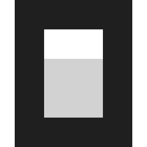

Graphify CLI is the open-source `graphifyy` package. The command is `graphify`. These pages install its skill into a coding agent so the agent can build a graph from the files on your machine.

This is not the hosted product. To query repositories you have indexed in the Graphify app, use [Integrations](/integrations/overview).

## Install the skill

```bash
uv tool install graphifyy
graphify install --platform cursor
```

Replace `cursor` with the platform value for your agent. The installer reports the files it writes. Refresh the agent if it does not see the skill, then ask it to map the current repository.

The default install is for your user. Add `--project` and run it from the repository root when you want the files in that repository, so a team can review them.

Slash commands are common. In Codex CLI, skills are in the `$` picker. The Codex desktop app lists local skills in the `@` menu: type `@graphify`. If an agent has no slash menu, ask it to use the Graphify skill.

| Agent | Platform | Guide |
| --- | --- | --- |
| Claude Code | `claude` | [Claude Code](/open-source/agents/claude-code) |
| Cursor | `cursor` | [Cursor](/open-source/agents/cursor) |
| Codex | `codex` | [Codex](/open-source/agents/codex) |
| VS Code and Copilot CLI | `copilot` | [VS Code](/open-source/agents/vscode) |
| Gemini CLI | `gemini` | [Gemini CLI](/open-source/agents/gemini-cli) |
| Hermes | `hermes` | [Hermes](/open-source/agents/hermes) |
| OpenCode, Antigravity, and others | see the page | [Other agents](/open-source/agents/other) |

The installer can also write rules or hooks so the agent checks the graph before it reads source. Hooks do not grant the agent new permissions. The always-on setup is on [Vibe coding with Graphify CLI](/open-source/vibe-coding).

An agent that already has a graph can read it through the [local MCP server](/open-source/mcp-server) without a skill install.

## Keep the skill current

```bash
uv tool upgrade graphifyy
graphify install --platform cursor
```

Use your platform value in place of `cursor`. If the skill is missing after an upgrade, refresh the agent and confirm the install landed in the user or project scope you intended. See [troubleshooting](/open-source/troubleshooting).

<style>{`
  @media (max-width: 639px) {
    .gfy-matrix table, .gfy-matrix tbody, .gfy-matrix tr, .gfy-matrix th, .gfy-matrix td { display: block; width: 100%; }
    .gfy-matrix thead { display: none; }
    .gfy-matrix tbody td { display: block; padding: 0 0 0 0; }
    .gfy-matrix tbody td::before { content: attr(data-label); display: block; font-size: 12px; color: #5c5c5c; margin-bottom: 4px; }
    .dark .gfy-matrix tbody td::before { color: #a3a3a3; }
  }
`}</style>

### Always-on context

"Always-on context" is what `graphify install` writes so the agent checks the graph before reading source, without being asked. Hooks never grant the agent new permissions.

<div className="gfy-matrix gfy-ctx not-prose my-6 overflow-hidden rounded-xl border border-[#e5e5e5] dark:border-[#262626]">
<table className="w-full table-fixed border-collapse text-[14px] leading-5 text-[#171717] dark:text-[#ededed] [&_code]:rounded [&_code]:bg-[#f5f5f5] dark:[&_code]:bg-[#1c1d1d] [&_code]:px-1.5 [&_code]:py-0.5 [&_code]:font-mono [&_code]:text-[12.5px] [&_code]:text-[#171717] dark:[&_code]:text-[#ededed]">
<colgroup><col style={{width: "30%"}} /><col style={{width: "70%"}} /></colgroup>
<thead className="bg-[#fafafa] dark:bg-[#141515]"><tr className="border-b border-[#e5e5e5] dark:border-[#262626]"><th scope="col" className="px-4 py-3 text-left align-middle text-[13px] font-semibold text-[#4a4a4a] dark:text-[#d4d4d4]">Agent</th><th scope="col" className="px-4 py-3 text-left align-middle text-[13px] font-semibold text-[#4a4a4a] dark:text-[#d4d4d4]">What <code>graphify install</code> writes</th></tr></thead>
<tbody>
<tr className="bg-white dark:bg-[#0f1110] border-b border-[#ebebeb] dark:border-[#1f1f1f]"><th scope="row" className="px-4 py-3 text-left align-middle font-normal"><a href="/open-source/agents/claude-code" className="inline-flex items-center gap-2.5 whitespace-nowrap font-medium text-[#171717] dark:text-[#ededed] no-underline hover:text-[#000000] dark:hover:text-[#ffffff]"><span>Claude Code</span></a></th><td data-label="What graphify install writes" className="px-4 py-3 text-left align-middle"><span><code>CLAUDE.md</code> and a PreToolUse hook</span></td></tr>
<tr className="bg-white dark:bg-[#0f1110] border-b border-[#ebebeb] dark:border-[#1f1f1f]"><th scope="row" className="px-4 py-3 text-left align-middle font-normal"><a href="/open-source/agents/cursor" className="inline-flex items-center gap-2.5 whitespace-nowrap font-medium text-[#171717] dark:text-[#ededed] no-underline hover:text-[#000000] dark:hover:text-[#ffffff]"><span>Cursor</span></a></th><td data-label="What graphify install writes" className="px-4 py-3 text-left align-middle"><span><code>.cursor/rules/graphify.mdc</code>, always applied</span></td></tr>
<tr className="bg-white dark:bg-[#0f1110] border-b border-[#ebebeb] dark:border-[#1f1f1f]"><th scope="row" className="px-4 py-3 text-left align-middle font-normal"><a href="/open-source/agents/codex" className="inline-flex items-center gap-2.5 whitespace-nowrap font-medium text-[#171717] dark:text-[#ededed] no-underline hover:text-[#000000] dark:hover:text-[#ffffff]"><span>Codex</span></a></th><td data-label="What graphify install writes" className="px-4 py-3 text-left align-middle"><span><code>AGENTS.md</code> and a PreToolUse hook in <code>.codex/hooks.json</code></span></td></tr>
<tr className="bg-white dark:bg-[#0f1110] border-b border-[#ebebeb] dark:border-[#1f1f1f]"><th scope="row" className="px-4 py-3 text-left align-middle font-normal"><a href="/open-source/agents/vscode" className="inline-flex items-center gap-2.5 whitespace-nowrap font-medium text-[#171717] dark:text-[#ededed] no-underline hover:text-[#000000] dark:hover:text-[#ffffff]"><span>VS Code and Copilot</span></a></th><td data-label="What graphify install writes" className="px-4 py-3 text-left align-middle"><span>Copilot instructions in VS Code</span></td></tr>
<tr className="bg-white dark:bg-[#0f1110] border-b border-[#ebebeb] dark:border-[#1f1f1f]"><th scope="row" className="px-4 py-3 text-left align-middle font-normal"><a href="/open-source/agents/gemini-cli" className="inline-flex items-center gap-2.5 whitespace-nowrap font-medium text-[#171717] dark:text-[#ededed] no-underline hover:text-[#000000] dark:hover:text-[#ffffff]"><span>Gemini CLI</span></a></th><td data-label="What graphify install writes" className="px-4 py-3 text-left align-middle"><span><code>GEMINI.md</code> and a BeforeTool hook</span></td></tr>
<tr className="bg-white dark:bg-[#0f1110] border-b border-[#ebebeb] dark:border-[#1f1f1f]"><th scope="row" className="px-4 py-3 text-left align-middle font-normal"><a href="/open-source/agents/other" className="inline-flex items-center gap-2.5 whitespace-nowrap font-medium text-[#171717] dark:text-[#ededed] no-underline hover:text-[#000000] dark:hover:text-[#ffffff]"><span>OpenClaw</span></a></th><td data-label="What graphify install writes" className="px-4 py-3 text-left align-middle"><span><code>AGENTS.md</code>, installed with <code>{"--platform claw"}</code></span></td></tr>
<tr className="bg-white dark:bg-[#0f1110] border-b border-[#ebebeb] dark:border-[#1f1f1f]"><th scope="row" className="px-4 py-3 text-left align-middle font-normal"><a href="/open-source/agents/hermes" className="inline-flex items-center gap-2.5 whitespace-nowrap font-medium text-[#171717] dark:text-[#ededed] no-underline hover:text-[#000000] dark:hover:text-[#ffffff]"><span>Hermes</span></a></th><td data-label="What graphify install writes" className="px-4 py-3 text-left align-middle"><span><code>AGENTS.md</code>, installed with <code>{"--platform hermes"}</code></span></td></tr>
<tr className="bg-white dark:bg-[#0f1110]"><th scope="row" className="px-4 py-3 text-left align-middle font-normal"><a href="/open-source/agents/other" className="inline-flex items-center gap-2.5 whitespace-nowrap font-medium text-[#171717] dark:text-[#ededed] no-underline hover:text-[#000000] dark:hover:text-[#ffffff]"><span>OpenCode</span></a></th><td data-label="What graphify install writes" className="px-4 py-3 text-left align-middle"><span><code>AGENTS.md</code> and a <code>tool.execute.before</code> plugin, installed with <code>{"graphify opencode install"}</code></span></td></tr>
</tbody></table></div>

<Visibility for="humans">
<div aria-hidden="true" data-graphify-site-styles="true" className="hidden [body:has(&)_.chat-assistant-floating-input::before]:!bg-transparent" />
</Visibility>

<Visibility for="humans">
<div role="navigation" aria-label="Documentation pages" className="not-prose mt-10 flex flex-wrap items-center justify-between gap-3">
  <a href="/open-source/self-host" rel="prev" className="group inline-flex items-center gap-2 rounded-md border border-[#d4d4d4] dark:border-[#262626] !border-b-[#d4d4d4] dark:!border-b-[#262626] bg-[#ffffff] dark:bg-[#141515] px-3 py-2 text-sm font-medium text-[#171717] dark:text-[#ededed] no-underline transition-colors hover:border-[#a3a3a3] dark:hover:border-[#404040] hover:!border-b-[#a3a3a3] dark:hover:!border-b-[#404040] hover:bg-[#f5f5f5] dark:hover:bg-[#1c1d1d] focus-visible:outline focus-visible:outline-2 focus-visible:outline-offset-4 focus-visible:outline-[#737373]"><span className="flex items-center gap-2 text-[11px] font-medium uppercase tracking-[0.08em] text-[#5c5c5c] dark:text-[#a3a3a3]"><svg width="14" height="14" viewBox="0 0 24 24" fill="none" stroke="currentColor" strokeWidth="1.8" aria-hidden="true"><path d="M15 5l-7 7 7 7" /></svg>Previous</span><span className="text-[15px] font-semibold leading-6">Self-host with Docker</span></a>
  <a href="/open-source/agents/claude-code" rel="next" className="group inline-flex items-center gap-2 rounded-md border border-[#d4d4d4] dark:border-[#262626] !border-b-[#d4d4d4] dark:!border-b-[#262626] bg-[#ffffff] dark:bg-[#141515] px-3 py-2 text-sm font-medium text-[#171717] dark:text-[#ededed] no-underline transition-colors hover:border-[#a3a3a3] dark:hover:border-[#404040] hover:!border-b-[#a3a3a3] dark:hover:!border-b-[#404040] hover:bg-[#f5f5f5] dark:hover:bg-[#1c1d1d] focus-visible:outline focus-visible:outline-2 focus-visible:outline-offset-4 focus-visible:outline-[#737373] ml-auto"><span className="flex items-center gap-2 text-[11px] font-medium uppercase tracking-[0.08em] text-[#5c5c5c] dark:text-[#a3a3a3]">Next<svg width="14" height="14" viewBox="0 0 24 24" fill="none" stroke="currentColor" strokeWidth="1.8" aria-hidden="true"><path d="M9 5l7 7-7 7" /></svg></span><span className="text-[15px] font-semibold leading-6">Claude Code</span></a>
</div>
</Visibility>

