import HostedMcpCard from '/snippets/hosted-mcp-card.mdx';

Open [Graphify](https://app.graphify.com?utm_source=docs&utm_medium=link&utm_campaign=platform-console). The sidebar is **Overview**, **Graphs**, **Wiki**, **Reviews**, **Formal Verification**, **Contributors**, **Team Digest**, **Builds**, **Repositories**, **Memory**, **Learn**, and **Connectors**.

The screens on this page are the public [graphify](https://github.com/Graphify-Labs/graphify) repository. **Search** is in the sidebar. The field along the bottom is **Deep research your codebase**.

## Overview

**Overview** is the workspace home. **All repositories** sets the scope. **Sync** refreshes the workspace. **Connect agent** opens the path to a coding assistant.

**Latest pull request** shows the newest review from the last 14 days, with its verdict and attention items. When a formal verification run matches the same repository, pull request number, and head commit, the card also shows that result and links to **Open review** (`/reviews?run=…`) and **Open FV run** (`/verifications?run=…`). If there is no recent review, the card is hidden.

**Code findings** lists **Checks incomplete**, **Duplicate code**, and **Dead code**. **Recent activity** includes pull requests reviewed. **Pick up where you left off** is where a recent review or finding returns. **Your indexed repositories** shows a graph card for each indexed repository, with **Combine graph** and **View all**. Further down, **Workspace stats** covers builds, code reviews, build outcomes, and graph density.

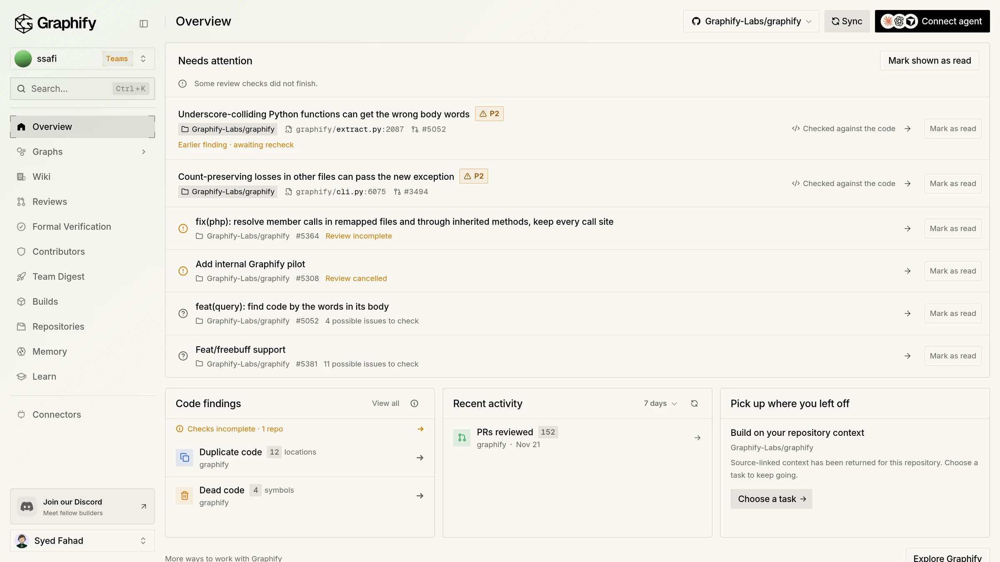

## Graphs

**Graphs** has two views.

**Single Repository** opens one graph. The header picks the repository, **All code areas**, and **Kind**. The counts are **Functions and files**, **Connections**, and **Context tokens saved**. Search sits beside the canvas, with the most connected areas.

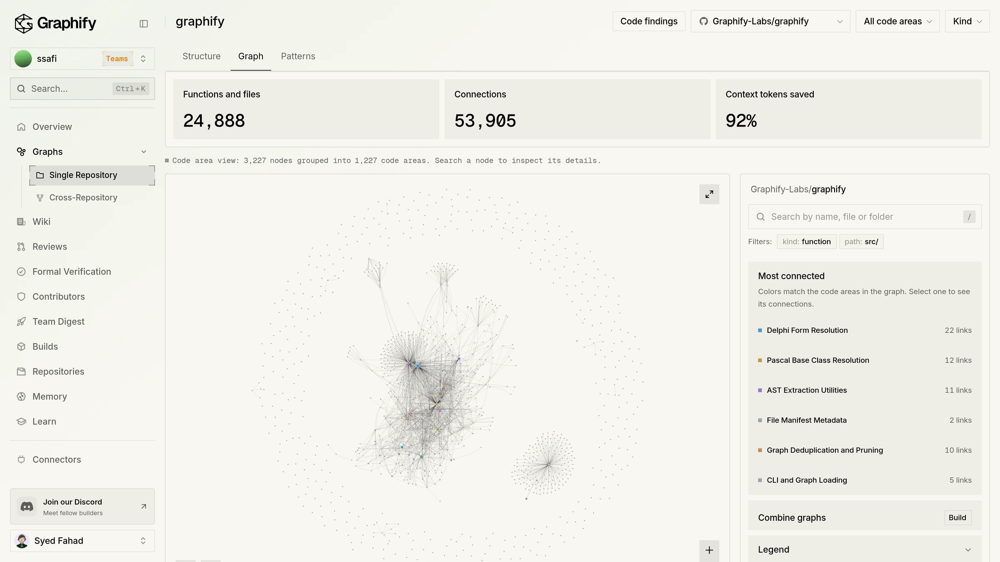

**Cross-Repository** opens a combined graph. Choose it from the menu in the header. The same counts sit above the canvas, and the side panel lists the most connected areas.

See [how Graphify works](/concepts/architecture) for graph structure and [edges and provenance](/concepts/provenance) for the meaning of the evidence labels.

## Wiki

**Wiki** turns an indexed repository into pages. Pick the repository, then browse **Areas** or use **Search pages**. **Reading mode** and **Ask** sit in the header. **On this page** follows the open article. See [Wiki](/platform/wiki) for indexing requirements and empty states.

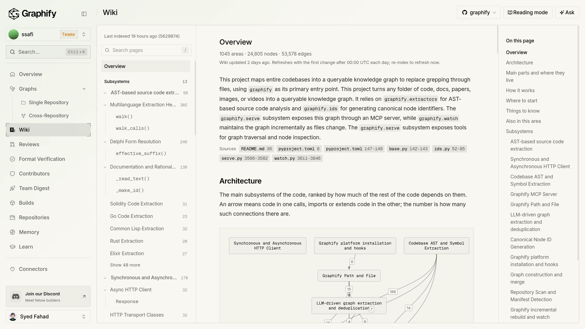

## Pull request reviews

**Reviews** lists pull requests for the workspace. **Search pull requests** filters the list. **All**, **Needs attention**, and **In progress** are the other filters, and **All repositories** narrows to one repository. The list is the **Latest review per PR**. A row shows a state such as **Review suggested**, **Action needed**, or **No blocking findings**, then **Reviewed** and the finding count. **Review** opens that run. Bug counts here count confirmed bugs only. Possible issues the review couldn't confirm have their own count, and a review with any of them stays under **Needs attention**. See [Merge confidence score](/platform/reviews#merge-confidence-score).

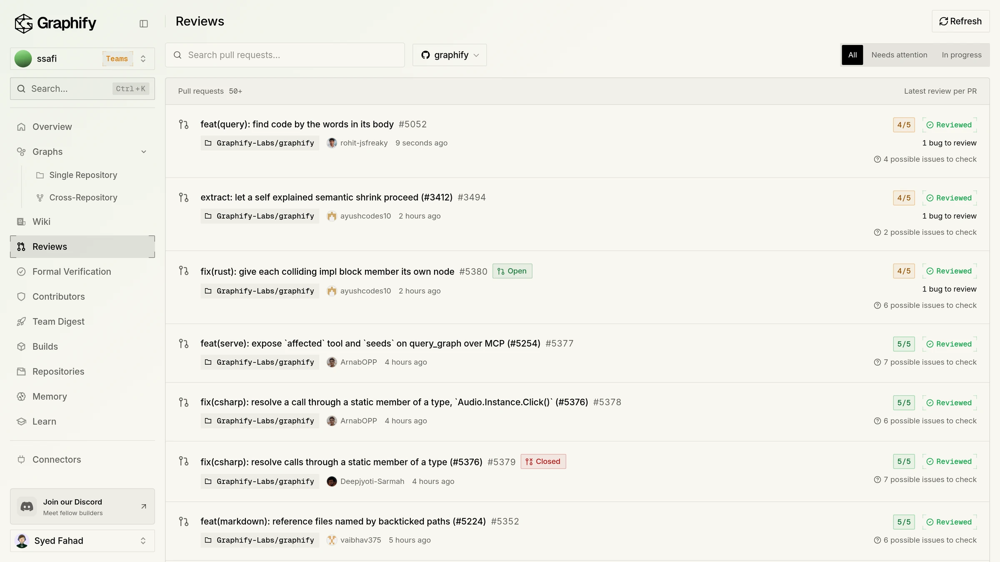

For the meaning and limits of verification verdicts, see [formal verification](/platform/verification). To investigate pull requests using the local CLI, see the [pull request guide](/open-source/features/pr-impact).

## Formal verification

**Formal Verification** lists behavior checks. The line under the title is **Check whether code changes affect behavior.** **How to read results** opens the legend. Each row is one pull request: a short result, **Completed** when the check finished, and **Open PR**. A result can say the change was tested, not proven. Read the [formal verification guide](/platform/verification) before interpreting a result.

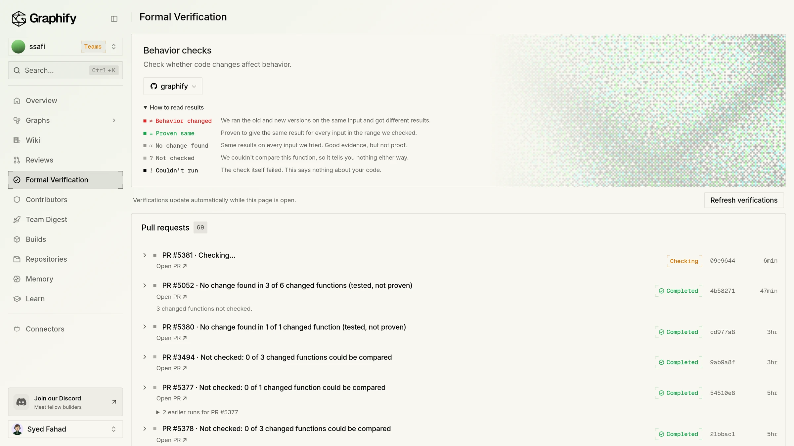

## Contributors

**Contributors** answers who contributes to the selected repository. **People to review** and **Contributors** are the two tabs. **Search by name or username** filters the list. A row shows commits, how many are signed, **AI**, and **Reach**. See [Contributors](/platform/contributors).

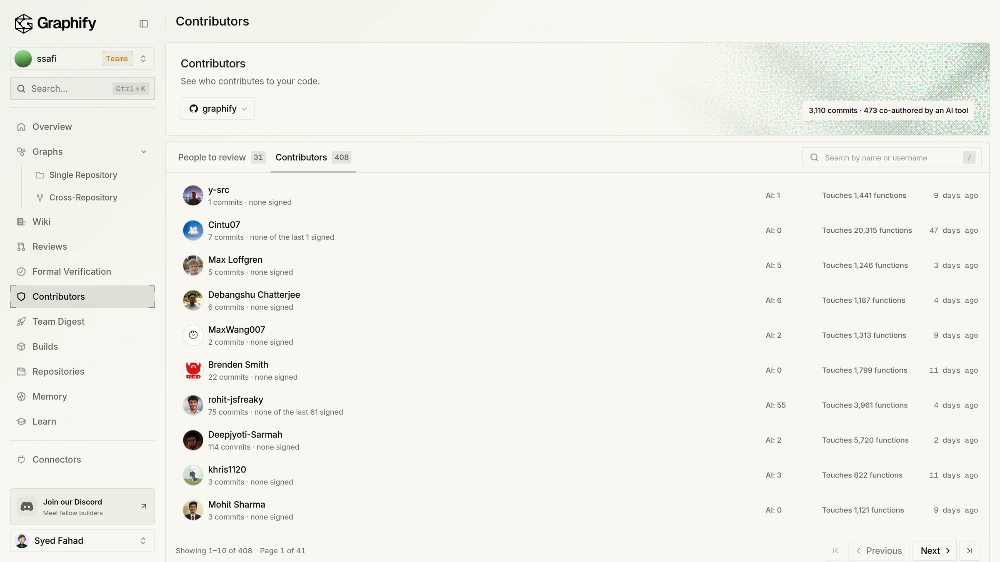

## Builds

**Builds** is the indexing history. The heading under the title is **Repository indexing**. Filter by repository and by status. The summary is **Total builds**, **Succeeded**, **Failed**, and **Nodes produced**. A failed build leaves the previous graph in place. **Recent builds** lists each run. See [Repositories and builds](/platform/repositories).

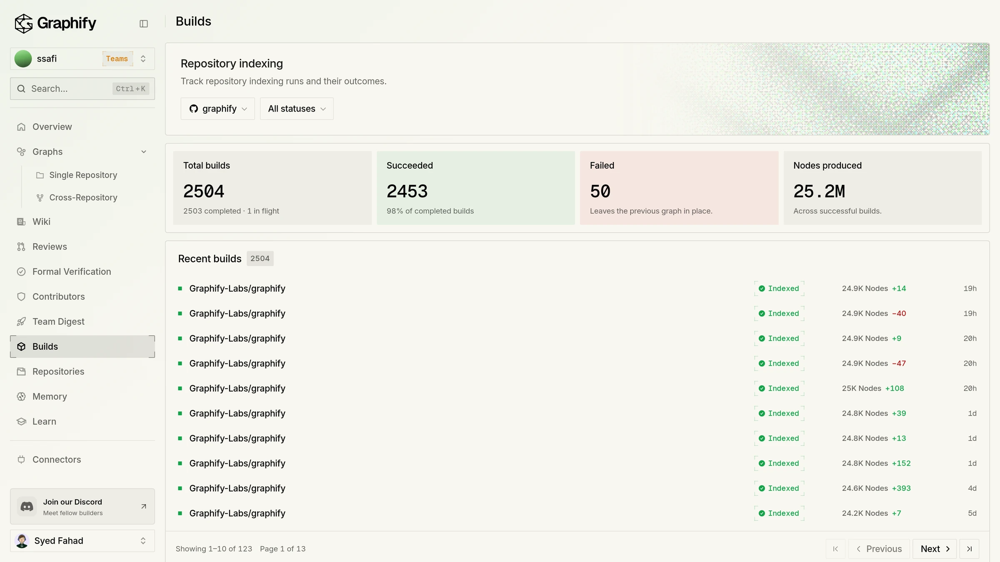

## Repositories

**Repositories** lists code repositories and Google Drive folders. **All**, **Code**, and **Drive** filter that list. **Search repositories and folders** is on the same page, with **Sync** and **Add GitHub repositories**. A row shows a status such as **Indexed** or **Paused**. See [Repositories and builds](/platform/repositories) and [Connect Google Drive](/integrations/google-drive). **Builds**, above, is that history for the repository you select.

## Memory

**Memory** is where the workspace keeps notes for one repository. **Simple** and **Advanced** switch the layout. **Add memory** saves a note. **Ask** and **Search** are the two ways in. Your agent keeps its own memory. Graphify adds shared knowledge, with no automatic syncing. See [Memory](/platform/memory).

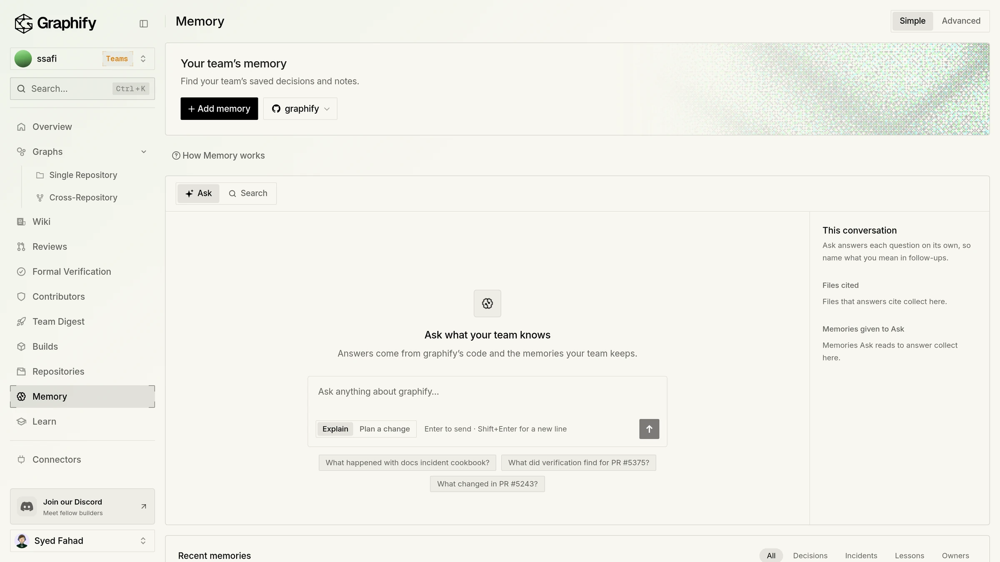

## Learn

The sidebar label and the page title are **Learn**. The section under the title is **Learning**: manage feedback on code reviews, then **Open reviews**. The counts are **Muted findings**, **Muted patterns**, and **Feedback last 30d**. **Learned dismissals** and **Suppressions** are read-only. See [Learning](/platform/learning) for the feedback commands.

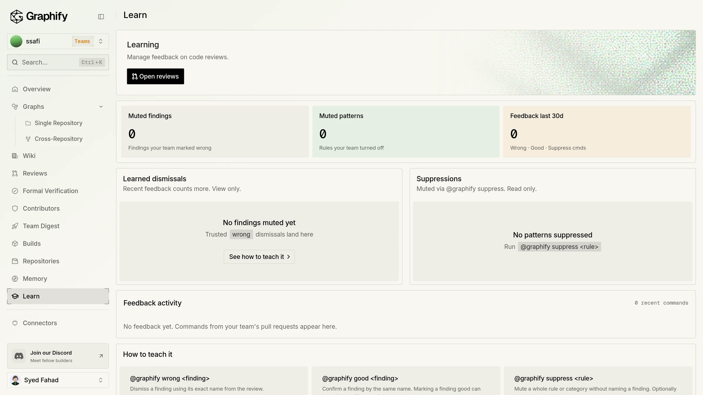

## Connectors

**Connectors** has two tabs.

**Agents (MCP)** connects a coding agent. The steps are **Choose agent**, **Connect**, and **Try a query**. The agent list includes Claude Code, Codex, Cursor, GitHub Copilot, and VS Code. **Default repository** is the repository used when an agent does not name one. Another client uses the hosted server `https://api.graphify.com/mcp`.

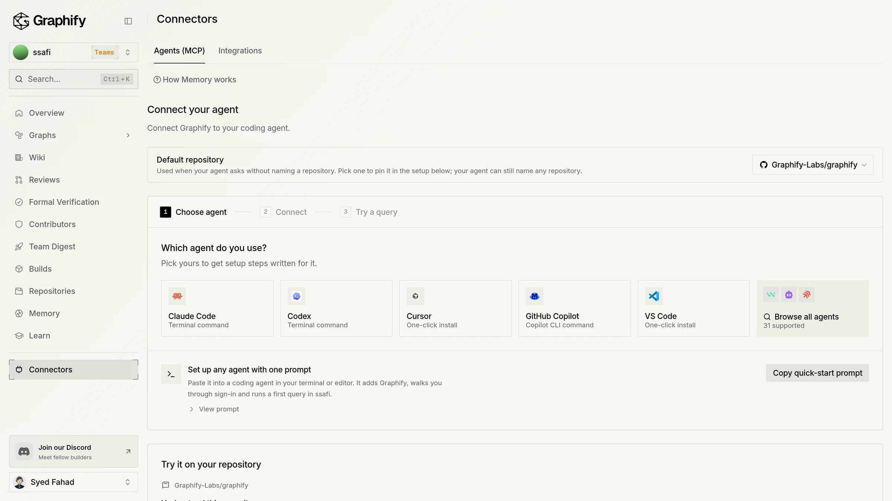

**Integrations** is **Connect your tools**. Filter by **Source control**, **Knowledge**, **Communication**, **Project management**, or **Developer tools**. A tile says **Connected**, **Connect**, or **Coming soon**. **Google Workspace** searches documents from Google Drive. See [Agents and integrations](/platform/connections) and [Connect Google Drive](/integrations/google-drive).

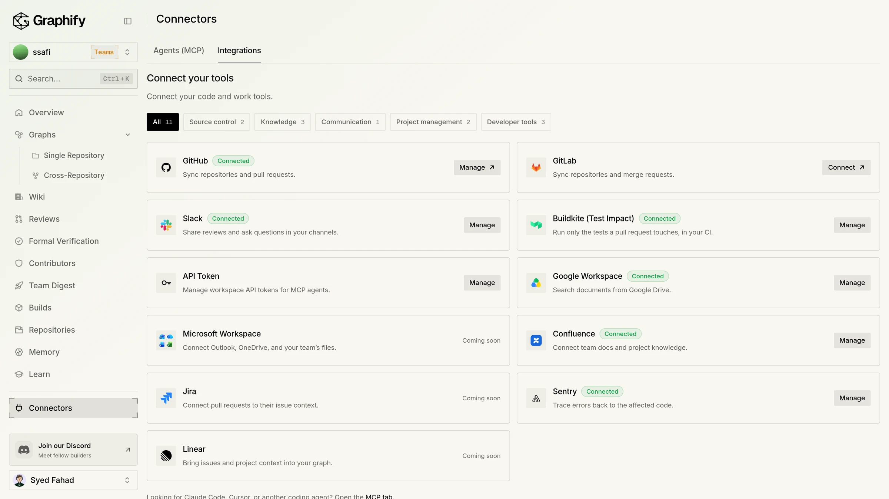

## Also in the workspace

- [Profile](/platform/profile) covers achievements, the last 7 days of Performance, and Power Ranking.

Some views depend on workspace access or a completed repository index. Their guides explain what to check when a view is unavailable or empty.

## Three everyday jobs

Graphify gives your team and your coding agents the same context: a code graph, a Wiki, pull request reviews and Memory. Here is how the pages above help with three jobs you do every week. Each takes a few minutes, and the agent steps need an agent connected to the [hosted MCP server](/platform/graphify-mcp).

### Onboard to a repository

**New to a codebase? Read the parts that matter first, not every file.**

<Steps>
  <Step title="Open the Wiki">
    Open **Wiki** and choose the repository. Start with **Overview**, then read the **Subsystems**. Each article lists **Key components** and **Relevant source files**. If you don't see **Wiki**, it isn't turned on for your workspace.
  </Step>
  <Step title="Look at the graph">
    Open **Graphs** to see the most connected areas. Select a node to read its **Incoming** and **Outgoing** connections, or use **Explain this code** for a plain explanation.
  </Step>
  <Step title="Ask your agent">
    Ask your connected agent the questions you'd ask a teammate. The answer cites files from the indexed graph, so you can open them and check.
  </Step>
</Steps>


```text Agent prompt
I'm new to this repository. Use Graphify: call graphify_rank_files for the most important files, then query_graph to explain how a request flows from the API layer to the database. Keep it to one page and cite files.
```

Go deeper: [Wiki](/platform/wiki), [Graph explorer](/platform/graphs), and the cookbook [Understand a new codebase in 30 minutes](/cookbooks/onboard-to-a-codebase).

### Check what a change breaks

**Know what a change reaches before you merge it, even in other repositories.**

<Steps>
  <Step title="Ask before you change code">
    Ask your agent what a function's change reaches, which files are riskiest, and which tests cover them. In **Graphs**, **What a change could affect** shows the same idea on the canvas.
  </Step>
  <Step title="Open a pull request">
    Graphify reviews a pull request when it is opened, reopened, or marked ready for review. The review comment and a **Graphify** check run show up on the pull request. After you push a fix, comment `@graphify review` for a fresh run.
  </Step>
  <Step title="Read the review">
    Open **Reviews** to see each pull request's state and finding count. Your agent can read the same result with the `review_status` tool.
  </Step>
  <Step title="See impact across repositories">
    Combine two or more repositories in **Graphs** > **Cross-Repository**. Reviews in those repositories then add a **Cross-repo impact** section that lists affected symbols in the other repositories.
  </Step>
</Steps>


```text Agent prompt
Use Graphify on Graphify-Labs/graphify: I want to change build_from_json.
What does that change reach, which files are riskiest, and which tests cover them?
```

Go deeper: [Pull request reviews](/platform/reviews), [Check the impact of a change](/concepts/check-impact), and the cookbooks [Map a dependency graph across multiple repos](/cookbooks/cross-repo-dependencies) and [Fix review findings](/cookbooks/fix-review-findings).

### Remember an incident

**The fix lands in git. The lesson should land somewhere your agents will read it.**

<Steps>
  <Step title="Record it">
    Open **Memory**, choose the repository, and switch to **Advanced**. Select **Record an incident**. Write what broke, the root cause, the fix, and the trap to avoid.
  </Step>
  <Step title="Link it to code">
    Under **More options**, set **Effective time** and add the files in **Related code paths**. Graphify checks them against the code graph and links the memory to that code.
  </Step>
  <Step title="Let agents recall it">
    Connected agents call `recall` before they edit that code. Add a short block to `AGENTS.md` or `CLAUDE.md` so they know when to call it.
  </Step>
</Steps>


```text Agent prompt
Before you edit src/payments/status.py, call recall about map_status and payment retries. Pass that path in paths and map_status in symbols.
```

Go deeper: [Memory](/platform/memory) and the cookbooks [Remember incident lessons](/cookbooks/remember-incident-lessons) and [Document the why](/cookbooks/document-the-why).

## Next steps

<HostedMcpCard />

<Columns cols={2}>
  <Card title="Repositories and builds" icon="git-commit-horizontal" href="/platform/repositories">
    Add and index repositories.
  </Card>
  <Card title="Pull request reviews" icon="git-pull-request" href="/platform/reviews">
    Turn on graph-aware reviews.
  </Card>
</Columns>

<Visibility for="humans">
<div aria-hidden="true" data-graphify-site-styles="true" className="hidden [body:has(&)_.chat-assistant-floating-input::before]:!bg-transparent [body:has(&)_#footer_a[href*='linkedin.com']_svg]:!bg-[#0a66c2] [body:has(&)_#footer_a[href*='discord.gg']_svg]:!bg-[#5865f2] [body:has(&)_#footer_a[href*='github.com']_svg]:!bg-[#181717] [body:has(&)_#footer_a[href*='x.com']_svg]:!bg-[#000000]" />
</Visibility>

<Visibility for="humans">
<div role="navigation" aria-label="Documentation pages" className="not-prose mt-10 flex flex-wrap items-center justify-between gap-3">
  <a href="/concepts/bring-your-stack" rel="prev" className="group inline-flex items-center gap-2 rounded-md border border-[#d4d4d4] dark:border-[#262626] !border-b-[#d4d4d4] dark:!border-b-[#262626] bg-[#ffffff] dark:bg-[#141515] px-3 py-2 text-sm font-medium text-[#171717] dark:text-[#ededed] no-underline transition-colors hover:border-[#a3a3a3] dark:hover:border-[#404040] hover:!border-b-[#a3a3a3] dark:hover:!border-b-[#404040] hover:bg-[#f5f5f5] dark:hover:bg-[#1c1d1d] focus-visible:outline focus-visible:outline-2 focus-visible:outline-offset-4 focus-visible:outline-[#737373]"><span className="flex items-center gap-2 text-[11px] font-medium uppercase tracking-[0.08em] text-[#5c5c5c] dark:text-[#a3a3a3]"><svg width="14" height="14" viewBox="0 0 24 24" fill="none" stroke="currentColor" strokeWidth="1.8" aria-hidden="true"><path d="M15 5l-7 7 7 7" /></svg>Previous</span><span className="text-[15px] font-semibold leading-6">Bring your stack to Graphify</span></a>
  <a href="/platform/ask" rel="next" className="group inline-flex items-center gap-2 rounded-md border border-[#d4d4d4] dark:border-[#262626] !border-b-[#d4d4d4] dark:!border-b-[#262626] bg-[#ffffff] dark:bg-[#141515] px-3 py-2 text-sm font-medium text-[#171717] dark:text-[#ededed] no-underline transition-colors hover:border-[#a3a3a3] dark:hover:border-[#404040] hover:!border-b-[#a3a3a3] dark:hover:!border-b-[#404040] hover:bg-[#f5f5f5] dark:hover:bg-[#1c1d1d] focus-visible:outline focus-visible:outline-2 focus-visible:outline-offset-4 focus-visible:outline-[#737373] ml-auto"><span className="flex items-center gap-2 text-[11px] font-medium uppercase tracking-[0.08em] text-[#5c5c5c] dark:text-[#a3a3a3]">Next<svg width="14" height="14" viewBox="0 0 24 24" fill="none" stroke="currentColor" strokeWidth="1.8" aria-hidden="true"><path d="M9 5l7 7-7 7" /></svg></span><span className="text-[15px] font-semibold leading-6">Ask</span></a>
</div>
</Visibility>
