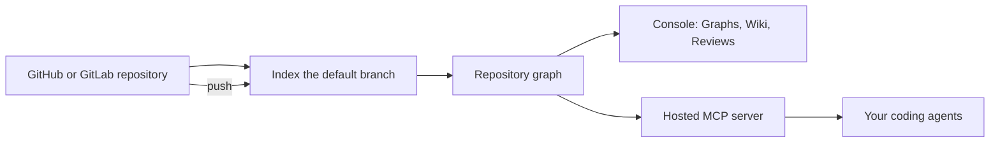

import Prerequisites from '/snippets/prerequisites.mdx';
import NextSteps from '/snippets/next-steps.mdx';

Graphify builds a knowledge graph of each repository you connect, keeps it current as you push, and serves it to your coding agents and your team.

<Prerequisites />

## 1. Connect a source

Install the Graphify GitHub App, or connect GitLab, and choose the repositories Graphify can read. Graphify asks only for the access it needs to read code and post reviews. See [Repositories](/platform/repositories).

## 2. Index the repository

When you switch on **Indexing** for a repository, Graphify builds a graph from the latest commit on its default branch. Each build runs in an isolated job that checks out that exact commit with short-lived, repository-scoped credentials.

The build uses the same open source engine as [Graphify Local](/open-source/quickstart): it parses code with tree-sitter, links calls, imports, and references across files, and groups related code into communities. [How the graph is built](/concepts/architecture) covers each stage.

## 3. Stay current

Every push to the default branch starts a new build. Your agents keep using the previous graph until the new one is ready, so a build in progress never leaves them without answers.

## 4. Use the graph

- **In the console**: explore [Graphs](/platform/graphs), read the generated [Wiki](/platform/wiki), and [trace](/platform/trace) who calls a function.
- **In your agent**: connect the hosted MCP server at `https://api.graphify.com/mcp`. Your agent signs in with OAuth and queries the graph with tools such as `graphify_node`, `graphify_callers`, and `graphify_impact`. See [Integrations](/integrations/overview).
- **On pull requests**: [Reviews](/platform/reviews) check each change against the graph and the diff.

## 5. Learn from your team

Replies such as `@graphify wrong` or `@graphify good` on a review feed [Learning](/platform/learning). Agents can save what they learn about a repository to [Memory](/platform/memory), which every assistant and teammate in the workspace can read.

## Next steps

<NextSteps />

  <a href="/platform/overview" rel="prev" className="group inline-flex items-center gap-2 rounded-md border border-[#c7dbd0] dark:border-[#262626] !border-b-[#c7dbd0] dark:!border-b-[#262626] bg-[#ffffff] dark:bg-[#141515] px-3 py-2 text-sm font-medium text-[#062314] dark:text-[#ededed] no-underline transition-colors hover:border-[#94b6a2] dark:hover:border-[#404040] hover:!border-b-[#94b6a2] dark:hover:!border-b-[#404040] hover:bg-[#edf6f0] dark:hover:bg-[#1c1d1d] focus-visible:outline focus-visible:outline-2 focus-visible:outline-offset-4 focus-visible:outline-[#4dea9c]"><svg width="14" height="14" viewBox="0 0 24 24" fill="none" stroke="currentColor" strokeWidth="1.8" aria-hidden="true"><path d="M15 5l-7 7 7 7" /></svg>PreviousGraphify</a>
  <a href="/platform/quickstart" rel="next" className="group inline-flex items-center gap-2 rounded-md border border-[#c7dbd0] dark:border-[#262626] !border-b-[#c7dbd0] dark:!border-b-[#262626] bg-[#ffffff] dark:bg-[#141515] px-3 py-2 text-sm font-medium text-[#062314] dark:text-[#ededed] no-underline transition-colors hover:border-[#94b6a2] dark:hover:border-[#404040] hover:!border-b-[#94b6a2] dark:hover:!border-b-[#404040] hover:bg-[#edf6f0] dark:hover:bg-[#1c1d1d] focus-visible:outline focus-visible:outline-2 focus-visible:outline-offset-4 focus-visible:outline-[#4dea9c] ml-auto">Next<svg width="14" height="14" viewBox="0 0 24 24" fill="none" stroke="currentColor" strokeWidth="1.8" aria-hidden="true"><path d="M9 5l7 7-7 7" /></svg>Graphify in 5 minutes</a>

