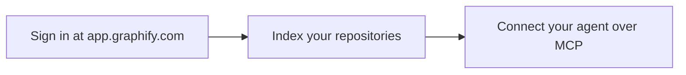

Graphify is a code knowledge graph of the repositories you connect. Your coding agent queries it over MCP, in Claude Code, Cursor, VS Code, and other clients.

On November 9, 2026, Sourcegraph [announced](https://sourcegraph.com/blog/sunsetting-cody-future-of-code-intelligence) that Cody reaches end of life on January 31, 2027. For code understanding, they point teams to Deep Search and their MCP integrations, and say those "aren't one-for-one replacements for every Cody capability."

This page maps Cody's features to what Graphify offers today, then gets you signed in, indexing repositories, and connected in your agent. You can keep using Cody until that end-of-life date.



## What carries over

Cody is an AI coding assistant in the editor, with chat, autocomplete, inline edits, and a prompt library. Graphify does not replace that editor assistant. It builds a graph of your code and gives that graph to the agent you already use.

The table is based on [Cody's product docs](https://sourcegraph.com/docs/cody) and [capabilities](https://sourcegraph.com/docs/cody/capabilities). It only includes Graphify features that are live today.

| Cody feature | In Graphify |
| --- | --- |
| Chat with codebase context | **Live.** Ask questions in Graphify with [Ask](/platform/ask), or in your agent with tools such as `query_graph`. See [Ask a question about your code](/concepts/ask-about-your-code) and [what your agent can do](/agents/capabilities). |
| Autocomplete | **Not offered.** Use your editor or agent for completions, such as Cursor Tab or GitHub Copilot. |
| Auto-edit | **Not offered.** Use your editor or agent for inline suggestions that follow your cursor. |
| Inline edit, Quick Edit, and Smart Apply | **Your agent does this.** Claude Code, Cursor, and similar tools apply edits in the editor. Graphify supplies the graph context those edits can draw on. |
| Prompts and Prompt Library | **Not offered.** Graphify has no prompt library and does not import Cody prompts. Recreate any you still need in your agent's rules. See [Use Graphify from your agent](/agents/recipes) and [Make your AI coding agent use the graph](/cookbooks/make-agents-use-the-graph). |
| @-mentions for files, symbols, and repositories | **Your agent, plus live tools.** Keep using your agent's @-mentions. For graph context, the agent calls tools such as `graphify_find`, `graphify_node`, and `list_repositories`. See [Graphify MCP](/platform/graphify-mcp). |
| Multi-repo and remote repository context | **Live.** Connect the repositories you need and, when you want one view, [combine them into a graph](/platform/graphs). |
| Context Filters (include and exclude rules on repository names) | **Not offered** in that form. You choose which repositories to connect and index. See [Repositories and builds](/platform/repositories). |
| IDE extensions (VS Code, JetBrains, Visual Studio, and the web app) | **Live as MCP connections**, not as a Cody-style assistant extension. Set up [Claude Code](/integrations/claude-code), [Cursor](/integrations/cursor), [VS Code and GitHub Copilot](/integrations/vscode), [JetBrains](/integrations/jetbrains), [Codex](/integrations/codex), or [another MCP client](/integrations/other-agents). Use the Graphify app to explore graphs, the wiki, and reviews. |
| Debug-oriented chat | **Your agent does this**, with graph tools such as `query_graph`, `graphify_tests_for`, and `graphify_trace`. |

Cody can also connect to local MCP servers to pull in extra context. Graphify works the other way around: it is the MCP server your agent connects to.

## Before you start

Sourcegraph has not published a bulk export or a date when Cody data is deleted. If you want a copy of your chats, the [Cody VS Code extension](https://sourcegraph.com/docs/cody/clients/install-vscode) can download chat history as a JSON file from the History icon. Prompt Library entries live in your Sourcegraph instance; copy any you still need into a file you control. Graphify does not import those files.

You'll need:

- A Graphify account. Create one at [app.graphify.com](https://app.graphify.com?utm_source=docs&utm_medium=link&utm_campaign=platform-migrate-from-cody) if you don't have one yet.
- A repository on GitHub or GitLab that you can connect.
- A coding agent that can add a remote MCP server, such as Claude Code, Cursor, Codex, or VS Code.

## Create an account and connect repositories

<Steps>
  <Step title="Sign in">
    Open [app.graphify.com](https://app.graphify.com?utm_source=docs&utm_medium=link&utm_campaign=platform-migrate-from-cody) and sign in with Google, GitHub, GitLab, or email.
  </Step>
  <Step title="Connect and index repositories">
    Add the repositories you want Graphify to read, switch on **Indexing**, and wait until the status is **Indexed**. Graphify indexes the latest commit on the default branch.

    The full walkthrough is in the [Quickstart](/platform/quickstart). For GitHub and GitLab details, build states, and retries, see [Index your first repository](/concepts/index-a-repository) and [Repositories and builds](/platform/repositories).
  </Step>
</Steps>

## Connect your agent

Add the MCP server at `https://api.graphify.com/mcp` and sign in with OAuth. There is no API key to paste.

Use the setup page for your client, rather than repeating the steps here:

- [Claude Code](/integrations/claude-code)
- [Cursor](/integrations/cursor)
- [VS Code and GitHub Copilot](/integrations/vscode)
- [JetBrains](/integrations/jetbrains)
- [Codex](/integrations/codex)
- [Other MCP clients](/integrations/other-agents)

The endpoint, tools, workspaces, and common fixes are on [Graphify MCP](/platform/graphify-mcp).

Then confirm the connection. In a new agent chat, paste:

```text
Use Graphify's list_repositories tool and show the repositories I can access. If the tool fails, report the error instead of guessing.
```

You should see a `list_repositories` call and your indexed repositories. If that fails, follow [Check your agent is using Graphify](/platform/verify-connection).

## Checklist

1. Sign in at [app.graphify.com](https://app.graphify.com?utm_source=docs&utm_medium=link&utm_campaign=platform-migrate-from-cody).
2. Connect each repository you want in the graph, and wait until it is **Indexed**.
3. Add the Graphify MCP server in your agent and finish the sign-in.
4. Run the `list_repositories` check above, then ask one question about your code that should use the graph.
5. Optional: turn on [pull request reviews](/platform/reviews), and read the [wiki](/platform/wiki) Graphify generates for each repository.
6. If you want to keep Cody chats or prompts, save them now. Graphify does not import them.
7. When you are ready, uninstall the Cody extension. Cody reaches end of life on January 31, 2027.

## What Graphify adds

These are not stand-ins for Cody features. They are already live, and they sit on the same graph:

- [Ask](/platform/ask): questions about your codebase in the Graphify app, with citations.
- [Wiki](/platform/wiki): generated docs for each indexed repository.
- [Pull request reviews](/platform/reviews): reviews that read the graph, not only the diff.

## Next steps

<Columns cols={2}>
  <Card title="Check it's working" icon="circle-check" href="/platform/verify-connection">
    Run the test prompts and fix a missing workspace or repository.
  </Card>
  <Card title="Make agents use the graph" icon="crosshair" href="/cookbooks/make-agents-use-the-graph">
    Tell your agent to query the graph before it greps, and prove that it did.
  </Card>
  <Card title="Keep the graph fresh" icon="refresh-cw" href="/platform/keep-the-graph-fresh">
    See what triggers a rebuild when you push to the default branch.
  </Card>
  <Card title="Pull request reviews" icon="git-pull-request" href="/platform/reviews">
    Get reviews that read the graph, not only the diff.
  </Card>
</Columns>
