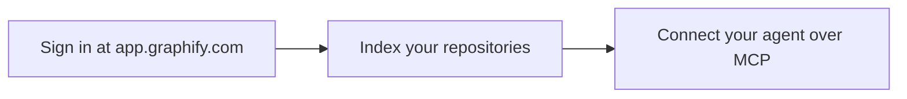

Cody reaches end of life on January 31, 2027. Sourcegraph [announced](https://sourcegraph.com/blog/sunsetting-cody-future-of-code-intelligence) that date on November 9, 2026, and said Deep Search and their MCP integrations "aren't one-for-one replacements for every Cody capability."

Graphify is a code knowledge graph of the repositories you connect. Claude Code, Cursor, Codex, and other agents all query the same graph over MCP. In the Graphify app you can [Ask](/platform/ask) questions, run [pull request reviews](/platform/reviews), read the [Wiki](/platform/wiki), and use [formal verification](/platform/verification) — all on that graph. Index the repositories that make up your codebase, [combine them](/platform/graphs) when you want one view, and a push to the default branch [keeps the graph current](/platform/keep-the-graph-fresh). Your agent gets that graph context instead of rereading source files into the conversation.

The [Quickstart](/platform/quickstart) gets you from sign-in to a connected agent in 5 minutes. Start at [app.graphify.com](https://app.graphify.com?utm_source=docs&utm_medium=link&utm_campaign=platform-migrate-from-cody).



## Sign in, index, and connect

You'll need a Graphify account, a repository on GitHub or GitLab that you can connect, and a coding agent that can add a remote MCP server, such as Claude Code, Cursor, Codex, or VS Code.

<Steps>
  <Step title="Sign in">
    Open [app.graphify.com](https://app.graphify.com?utm_source=docs&utm_medium=link&utm_campaign=platform-migrate-from-cody) and sign in with Google, GitHub, GitLab, or email.
  </Step>
  <Step title="Connect and index repositories">
    Add the repositories you want Graphify to read, switch on **Indexing**, and wait until the status is **Indexed**. Graphify indexes the latest commit on the default branch. After that, a push to the default branch updates the graph. Pushes to other branches don't.

    The full walkthrough is in the [Quickstart](/platform/quickstart). For GitHub and GitLab details, build states, and retries, see [Index your first repository](/concepts/index-a-repository) and [Repositories and builds](/platform/repositories).
  </Step>
  <Step title="Connect your agent">
    Add the MCP server at `https://api.graphify.com/mcp` and sign in with OAuth. There is no API key to paste.

    Use the setup page for your client:

    - [Claude Code](/integrations/claude-code)
    - [Cursor](/integrations/cursor)
    - [VS Code and GitHub Copilot](/integrations/vscode)
    - [JetBrains](/integrations/jetbrains)
    - [Codex](/integrations/codex)
    - [Other MCP clients](/integrations/other-agents)

    The endpoint, tools, workspaces, and common fixes are on [Graphify MCP](/platform/graphify-mcp).
  </Step>
  <Step title="Check the connection">
    In a new agent chat, paste:

    ```text
    Use Graphify's list_repositories tool and show the repositories I can access. If the tool fails, report the error instead of guessing.
    ```

    You should see a `list_repositories` call and your indexed repositories. If that fails, follow [Check your agent is using Graphify](/platform/verify-connection).
  </Step>
</Steps>

## What you get

This table is based on [Cody's product docs](https://sourcegraph.com/docs/cody) and [capabilities](https://sourcegraph.com/docs/cody/capabilities), matched to Graphify features that are live today.

| If you used Cody for | In Graphify |
| --- | --- |
| Chat with codebase context | [Ask](/platform/ask) in the Graphify app, or ask your agent, which queries the graph with tools such as `query_graph`. See [Ask a question about your code](/concepts/ask-about-your-code) and [what your agent can do](/agents/capabilities). |
| Context across repositories | Connect the repositories you need and [combine them into one graph](/platform/graphs). |
| Working in the editor | Connect the agent you already use over MCP: [Claude Code](/integrations/claude-code), [Cursor](/integrations/cursor), [Codex](/integrations/codex), [VS Code](/integrations/vscode), [JetBrains](/integrations/jetbrains), or [another MCP client](/integrations/other-agents). |

On the same graph, you also get [pull request reviews](/platform/reviews), a [Wiki](/platform/wiki) for each indexed repository, and [formal verification](/platform/verification) of changed functions.

## Checklist

1. Sign in at [app.graphify.com](https://app.graphify.com?utm_source=docs&utm_medium=link&utm_campaign=platform-migrate-from-cody).
2. Connect each repository you want in the graph, and wait until it is **Indexed**.
3. Add the Graphify MCP server in your agent and finish the sign-in.
4. Run the `list_repositories` check above, then ask one question about your code that should use the graph.
5. Optional: turn on [pull request reviews](/platform/reviews), read the [wiki](/platform/wiki), and look at [formal verification](/platform/verification).
6. When you're ready, uninstall the Cody extension. Cody reaches end of life on January 31, 2027.

<Note>
If you want to keep a copy of your Cody chats, the [Cody VS Code extension](https://sourcegraph.com/docs/cody/clients/install-vscode) can download them as a JSON file from the History icon.
</Note>

## Next steps

<Columns cols={2}>
  <Card title="Check it's working" icon="circle-check" href="/platform/verify-connection">
    Run the test prompts and fix a missing workspace or repository.
  </Card>
  <Card title="Keep the graph fresh" icon="refresh-cw" href="/platform/keep-the-graph-fresh">
    A push to the default branch updates the graph. Pushes to other branches don't.
  </Card>
  <Card title="Pull request reviews" icon="git-pull-request" href="/platform/reviews">
    Get reviews that read the graph, not only the diff.
  </Card>
  <Card title="Formal verification" icon="shield-check" href="/platform/verification">
    Prove a changed function still behaves like the previous version.
  </Card>
</Columns>
