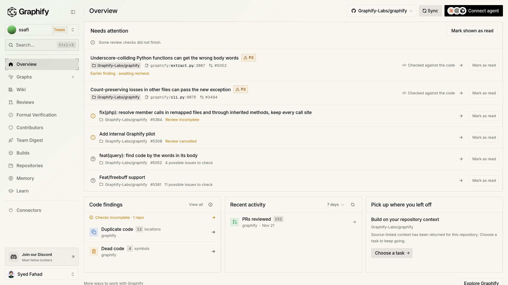
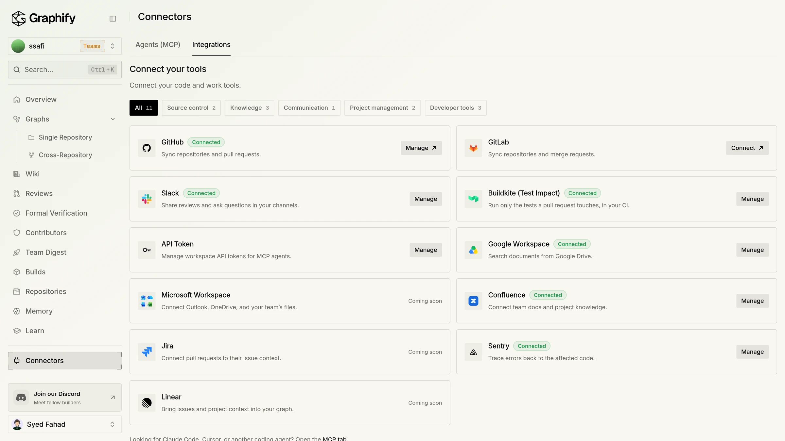
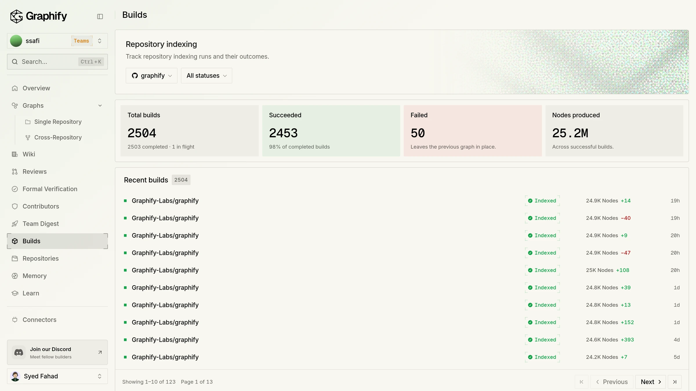
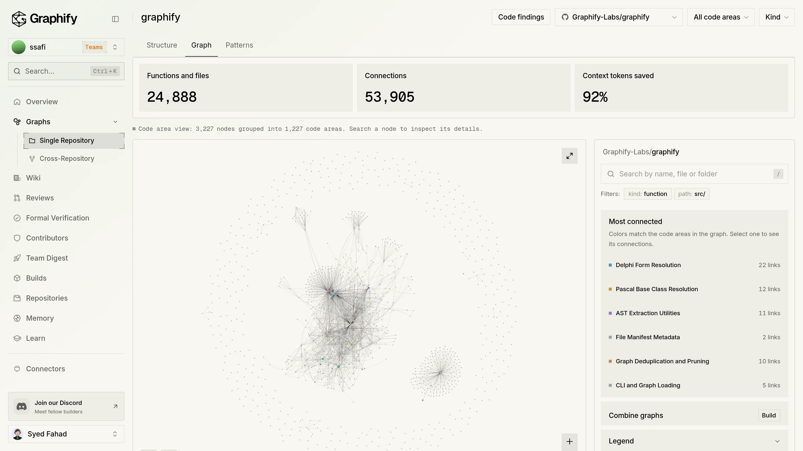
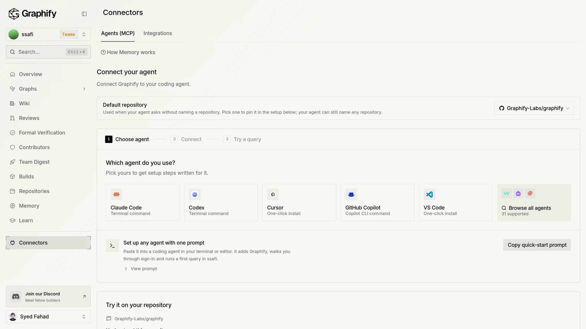

import { StartFreeCta } from '/snippets/start-free-cta.mdx';

This page gets you started with Graphify, the hosted product at app.graphify.com. We run it for you, so there's nothing to deploy. It indexes your GitHub repositories, builds a code graph and a wiki for each one, and serves the graph and your team's Memory to your coding agent over a hosted MCP server. There is nothing to install on your machine either.

You need a GitHub account with access to the repository and a coding agent that supports MCP. You also need a Graphify account. If you don't have one yet, you can create one for free while connecting, or sign in below. The Free plan needs no card. See [Plans and pricing](/platform/support/pricing). If you'd rather keep the graph on your machine, use open-source Graphify, the `graphifyy` package, with the [local quickstart](/open-source/quickstart).

<Note>
If you are an agent, read [Notes for agents](/for-agents) before these steps.
</Note>

## Start from your agent

You can also set Graphify up from your coding agent, and sign in when it asks. If you are in the Graphify app and the page says **Set up Graphify with your agent**, click **Copy setup prompt** and paste it into the agent. You can paste this prompt yourself:

```text
Set up Graphify for me.
Add the Graphify MCP server at https://api.graphify.com/mcp and sign in when it asks.
Most agents only load new MCP tools after a restart. If Graphify's tools don't show up yet, ask me to restart you; I'll then say "continue Graphify setup".
Then call its setup_status tool and walk me through any step it lists.
```

Most agents need a restart after adding Graphify. Then say "continue Graphify setup". The agent walks you through any step `setup_status` lists, such as connecting GitHub. On that page you can pick up to 3 repositories to index.

The steps below are the same setup in the Graphify app, if you would rather click through it yourself.

<Steps>
  <Step title="Sign in" titleSize="h2">
    Open the Graphify app at [app.graphify.com](https://app.graphify.com?utm_source=docs&utm_medium=link&utm_campaign=platform-quickstart) and sign in. You land on **Overview**. It may ask **What would you like to do first?** You can pick an option or skip it, since the steps below cover the same ground.

    
  </Step>
  <Step title="Connect GitHub" titleSize="h2">
    Go to **Repositories** and click **Add GitHub repositories**, then grant the Graphify GitHub App access to the repositories you want. You can also connect from **Connectors → Integrations**. For GitLab, click **Connect** on the GitLab card in **Connectors** and grant access in GitLab's flow.

    Connected repositories show up as **Paused** and **Not indexed**. That's expected, because nothing is indexed until you choose to.

    
  </Step>
  <Step title="Index a repository" titleSize="h2">
    Find the repository, open its **…** menu, and switch on **Indexing**. This queues the first build. You can also click **Index** next to a repository card on **Overview**.

    Repository allowances depend on your plan. On **Teams**, repositories and Google Drive sources are shared with everyone in the workspace. Switch workspaces from the switcher at the top of the sidebar. See [Plans and pricing](/platform/support/pricing).

    Hosted Graphify lists 63 grammars. Open-source Graphify supports 40 languages (33 tree-sitter, 7 built-in). See [Bring your stack to Graphify](/concepts/bring-your-stack).

    Follow the run on **Builds**. When it finishes, the repository's status changes to **Indexed**. To try it on a public codebase, index a fork of [Graphify-Labs/graphify](https://github.com/Graphify-Labs/graphify).

    
  </Step>
  <Step title="Look at the graph and wiki" titleSize="h2">
    Open **Graphs** to explore the repository's nodes and their most connected areas. Then open **Wiki**, which writes an article for each area of the repository automatically. **Memory** lets you ask or search across what Graphify knows. For a guided tour of the graph, see [Read your code graph and clean up your repos](/cookbooks/read-your-graph).

    
  </Step>
  <Step title="Connect your agent" titleSize="h2">
    Go to **Connectors → Agents (MCP)**. The wizard has three steps: **Choose agent**, **Connect**, and **Try a query**. It writes setup steps for Claude Code, Codex, Cursor, GitHub Copilot, VS Code, and many more agents (open **Browse all agents** for the full list).

    Prefer one click? Use [Connect Graphify in Claude](https://claude.ai/directory/graphify) ([Claude.ai and Desktop](/integrations/claude-ai), [Claude Code](/integrations/claude-code)), the [Graphify plugin for Cursor](https://cursor.com/marketplace/graphify), the [Graphify extension for VS Code](https://marketplace.visualstudio.com/items?itemName=graphify-labs.graphify-mcp), the [Graphify plugin for ChatGPT and Codex](https://chatgpt.com/plugins/plugin_asdk_app_6abe89f7f5d88191b9422522bb8562a4), or the [Graphify plugin for Grok Bot](https://x.ai/bot/plugin/90729235). Each one connects to the same hosted server, and you sign in with OAuth.

    You can also add the server yourself. Each agent takes one line or one config entry:

    <CodeGroup>
    ```bash Claude Code
    claude mcp add --transport http --scope user graphify https://api.graphify.com/mcp
    ```
    ```bash Codex plugin
    codex plugin marketplace add Graphify-Labs/graphify-codex-plugin
    codex plugin add graphify@graphify
    codex mcp login graphify
    ```
    ```bash Codex (manual)
    codex mcp add graphify --url https://api.graphify.com/mcp
    codex mcp login graphify
    ```
    ```json VS Code (.vscode/mcp.json)
    {
      "servers": {
        "graphify": { "type": "http", "url": "https://api.graphify.com/mcp" }
      }
    }
    ```
    ```text Any MCP client
    Name: graphify
    URL:  https://api.graphify.com/mcp   (Streamable HTTP)
    ```
    </CodeGroup>

    No `claude` command in your terminal? The Claude desktop app and IDE extensions may not add one. Use the `~/.claude.json` steps on the [Claude Code page](/integrations/claude-code#no-claude-command-edit-the-config-file).

    The first connection opens an OAuth sign-in. There is no API key to paste. If you don't know how to configure your agent, click **Copy quick-start prompt** and paste it into the agent. It adds Graphify, walks you through sign-in, and runs a first query.

Watch the connection status on **Try a query**: it shows "Connected. Graphify just received a tool call from your account." when a call lands, or "Connected. Last tool call from your account: …" if Graphify already has a call from the last 30 days. After indexing finishes, use the starter tasks under **Try it on your repository**, and copy the rules block into your agent's instructions file. Details and fixes: [Check it's working](/platform/verify-connection).

    

    Agent-specific guides: [VS Code](/integrations/vscode), [JetBrains](/integrations/jetbrains), [ChatGPT](/integrations/chatgpt), [OpenClaw](/integrations/openclaw), [Vercel](/integrations/vercel), [OpenCode](/cookbooks/opencode), and [any other MCP client](/integrations/other-agents).
  </Step>
  <Step title="Run a first task" titleSize="h2">
    Under **Get your first useful result** on the same page, click **Copy first task** and paste it into your agent. Or ask in your own words:

    ```text
    Using Graphify, explain what this repository does, trace one main entry point, and show the files involved.
    ```

    The answer cites source locations from the indexed graph. Open them to check. For help reading the answer, see [Read a result](/platform/reviews/read-a-result).
  </Step>
</Steps>

## What updates the graph

After the first build, Graphify keeps the graph in step with your default branch.

| Event | What happens |
| --- | --- |
| A push to the default branch | Graphify indexes that commit. |
| A push to any other branch | Nothing. The graph follows the default branch only. |
| A pull request | Nothing from the pull request's branch is saved as an index. The review analyzes the full pull request, from where it branched to its latest commit. It uses the graph to understand how the changes affect the surrounding code. |
| **Retry** on a failed build | Graphify indexes the current head of the default branch. |

One index of a repository runs at a time. A later push waits, or joins the build already queued. Hosted plans can limit how many push-triggered indexes finish in a UTC day; a manual reindex does not count. See [Plans and pricing](/platform/support/pricing) and [How Graphify keeps your graph fresh](/concepts/keep-the-graph-fresh).

## If something looks wrong


| Symptom | Fix |
| --- | --- |
| A banner says **Your agent is pointed at a different workspace** | Click **Point my agent at _workspace name_** on the banner, or switch to the workspace your agent uses. |
| The agent asks for an API key | The server uses OAuth. Check the URL is `https://api.graphify.com/mcp`. |
| You only see the local tools | That connection reads a local graph file. Add the hosted URL above instead. The hosted list is whatever your client shows from `tools/list`. |
| The agent says there are no repositories | Wait for **Indexed** on **Repositories**, or set a default repository in **Connectors → Agents (MCP)**. |
| Setup says **This repository has no commits yet, so there is nothing to index.** | Push a commit to the default branch, then select **Re-sync repositories**, or choose another repository. |
| The repository is not in the list | Grant the Graphify app access to it on GitHub or GitLab, then return to **Repositories**. |
| You can't switch on indexing | On Free, check that fewer than 3 repositories are indexed. |
| The status is **Failed** | Open **Builds**, read the failed run, then choose **Retry**. |
| The status is **Out of date** | The newest default-branch commit is not the one the graph serves, and no build is running. Start a reindex. |

To confirm your agent is connected and picks Graphify over grep, see [Check your agent is using Graphify](/platform/verify-connection). [Repositories and builds](/platform/repositories) covers every status and control, and more fixes are in [When you're stuck](/platform/support/faqs).

## Next steps

Not sure what to try first? [Three everyday jobs](/platform/console#three-everyday-jobs) walks through: onboarding to a repository, checking what a change breaks, and remembering an incident.

<Columns cols={2}>
  <Card title="Trace a change" icon="route" href="/open-source/features/trace">
    Follow a relationship across files and repositories.
  </Card>
  <Card title="Tour the Graphify app" icon="layout-dashboard" href="/platform/console">
    Every page in app.graphify.com, explained.
  </Card>
  <Card title="Review pull requests" icon="git-pull-request" href="/platform/reviews">
    Get a cross-repo PR review on each new pull request, with findings that read the graph.
  </Card>
  <Card title="Already use local Graphify?" icon="laptop" href="/platform/support/move-from-local">
    Move from a local graph to Graphify.
  </Card>
</Columns>

<StartFreeCta campaign="platform-quickstart" content="end-cta-quickstart" title="Ready when you are">Create your workspace and index your first repository. There is nothing to install.</StartFreeCta>
