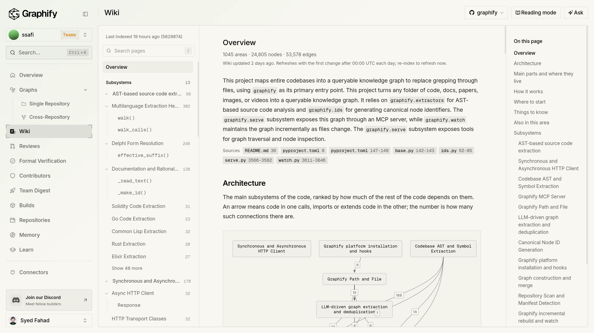
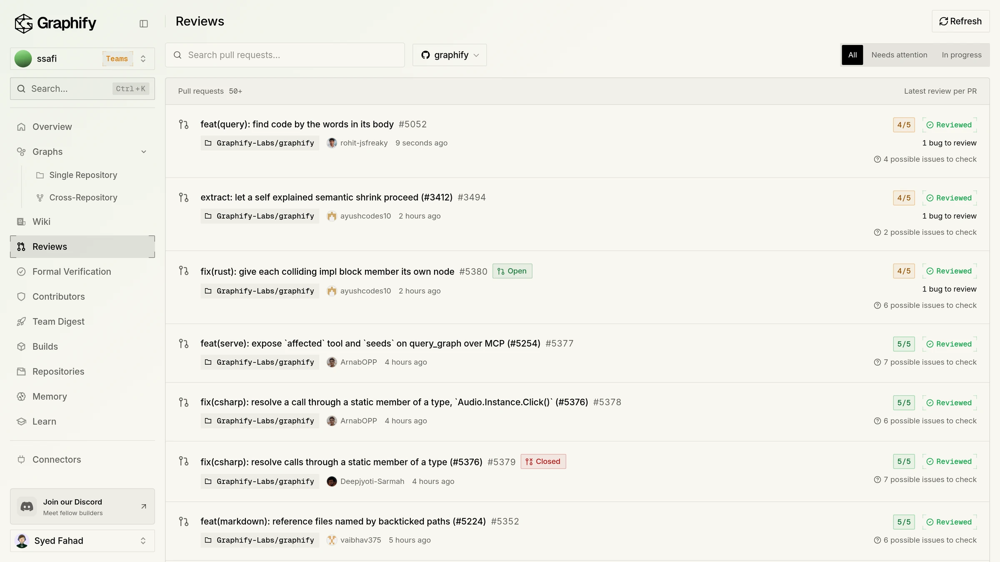
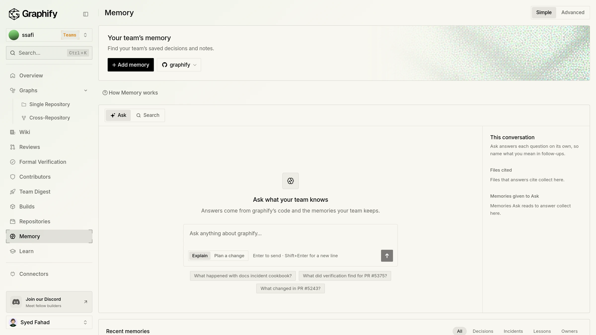
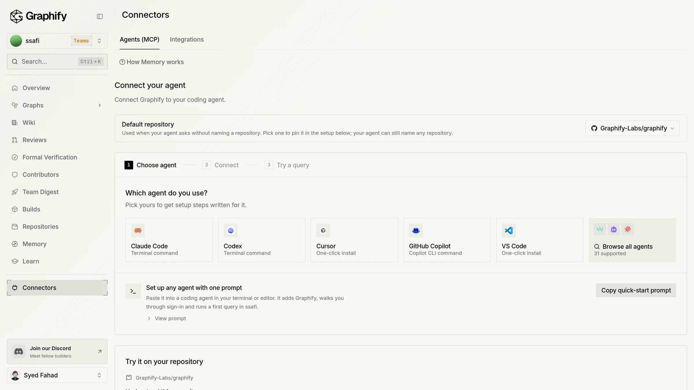

import WorksWith from '/snippets/works-with.mdx';

Graphify gives your team and your coding agents the same context: a code graph, a Wiki, pull request reviews and Memory. This tour shows how they help with three jobs you do every week. Each job takes a few minutes.

<WorksWith />

<CardGroup cols={3}>
  <Card title="Onboard to a repository" icon="compass" href="#onboard-to-a-repository">
    Find where to start reading, then ask your agent.
  </Card>
  <Card title="Check what a change breaks" icon="radar" href="#check-what-a-change-breaks">
    See what a change reaches, in this repository and others.
  </Card>
  <Card title="Remember an incident" icon="siren" href="#remember-an-incident">
    Save the lesson so the next agent doesn't undo the fix.
  </Card>
</CardGroup>

## Before you start

- A repository with the status **Indexed** in [Graphify](https://app.graphify.com?utm_source=docs&utm_medium=link&utm_campaign=platform-tour). The [quickstart](/platform/quickstart) gets you there in 5 minutes.
- A coding agent connected to the hosted MCP server, for the agent steps. See [Connect your agent](#connect-your-agent) below.

## Onboard to a repository

**New to a codebase? Read the parts that matter first, not every file.**

<Steps>
  <Step title="Open the Wiki">
    Open **Wiki** and choose the repository. Start with **Overview**, then read the **Subsystems**. Each article lists **Key components** and **Relevant source files**. If you don't see **Wiki**, it isn't turned on for your workspace.
  </Step>
  <Step title="Look at the graph">
    Open **Graphs** to see the most connected areas. Select a node to read its **Incoming** and **Outgoing** connections, or use **Explain this code** for a plain explanation.
  </Step>
  <Step title="Ask your agent">
    Ask your connected agent the questions you'd ask a teammate. The answer cites files from the indexed graph, so you can open them and check.
  </Step>
</Steps>



```text Agent prompt
I'm new to this repository. Use Graphify: call graphify_rank_files for the most important files, then query_graph to explain how a request flows from the API layer to the database. Keep it to one page and cite files.
```

Go deeper: [Wiki](/platform/wiki), [Graph explorer](/platform/graphs), and the cookbook [Understand a new codebase in 30 minutes](/cookbooks/onboard-to-a-codebase).

## Check what a change breaks

**Know what a change reaches before you merge it, even in other repositories.**

<Steps>
  <Step title="Ask before you change code">
    Ask your agent what a function's change reaches, which files are riskiest, and which tests cover them. In **Graphs**, **What a change could affect** shows the same idea on the canvas.
  </Step>
  <Step title="Open a pull request">
    Graphify reviews a pull request when it is opened, reopened, or marked ready for review. The review comment and a **Graphify** check run show up on the pull request. After you push a fix, comment `@graphify review` for a fresh run.
  </Step>
  <Step title="Read the review">
    Open **Reviews** to see each pull request's state and finding count. Your agent can read the same result with the `review_status` tool.
  </Step>
  <Step title="See impact across repositories">
    Combine two or more repositories in **Graphs** > **Cross-Repository**. Reviews in those repositories then add a **Cross-repo impact** section that lists affected symbols in the other repositories.
  </Step>
</Steps>



```text Agent prompt
Use Graphify on Graphify-Labs/graphify: I want to change build_from_json.
What does that change reach, which files are riskiest, and which tests cover them?
```

Go deeper: [Pull request reviews](/platform/reviews), [Check the impact of a change](/concepts/check-impact), and the cookbooks [Map a dependency graph across multiple repos](/cookbooks/cross-repo-dependencies) and [Fix review findings](/cookbooks/fix-review-findings).

## Remember an incident

**The fix lands in git. The lesson should land somewhere your agents will read it.**

<Steps>
  <Step title="Record it">
    Open **Memory**, choose the repository, and switch to **Advanced**. Select **Record an incident**. Write what broke, the root cause, the fix, and the trap to avoid.
  </Step>
  <Step title="Link it to code">
    Under **More options**, set **Effective time** and add the files in **Related code paths**. Graphify checks them against the code graph and links the memory to that code.
  </Step>
  <Step title="Let agents recall it">
    Connected agents call `recall` before they edit that code. Add a short block to `AGENTS.md` or `CLAUDE.md` so they know when to call it.
  </Step>
</Steps>



```text Agent prompt
Before you edit src/payments/status.py, call recall about map_status and payment retries. Pass that path in paths and map_status in symbols.
```

Go deeper: [Memory](/platform/memory) and the cookbooks [Remember incident lessons](/cookbooks/remember-incident-lessons) and [Document the why](/cookbooks/document-the-why).

## Connect your agent

**Every job above works best when your agent can read the same graph.**

Go to **Connectors** > **Agents (MCP)**. The wizard walks you through **Choose agent**, **Connect**, and **Try a query**. Sign-in uses OAuth, so there is no API key to paste.



<AccordionGroup>
  <Accordion title="Add the server yourself">
    Any MCP client can use `https://api.graphify.com/mcp` over Streamable HTTP.

    ```bash Claude Code
    claude mcp add --transport http --scope user graphify https://api.graphify.com/mcp
    ```

    Setup for every client is on [Graphify MCP](/platform/graphify-mcp).
  </Accordion>
  <Accordion title="Check that your agent uses Graphify">
    See [Check your agent is using Graphify](/platform/verify-connection). To make your agent use the graph without being told, see [Make agents use the graph](/cookbooks/make-agents-use-the-graph).
  </Accordion>
  <Accordion title="Where can I see every page of the app?">
    [Tour the Graphify app](/platform/console) walks through each page in the sidebar.
  </Accordion>
</AccordionGroup>

## Next steps

<Columns cols={2}>
  <Card title="Use Graphify from your agent" icon="list-checks" href="/agents/recipes">
    Copy-ready prompts for review, impact, callers, and tests.
  </Card>
  <Card title="All cookbooks" icon="book-open" href="/cookbooks/overview">
    Step-by-step recipes for common jobs.
  </Card>
</Columns>
