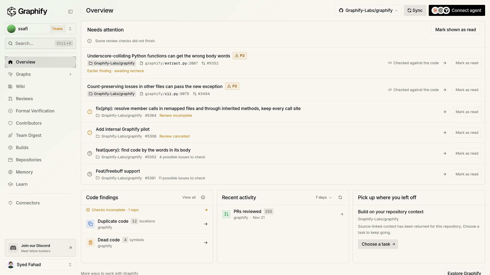
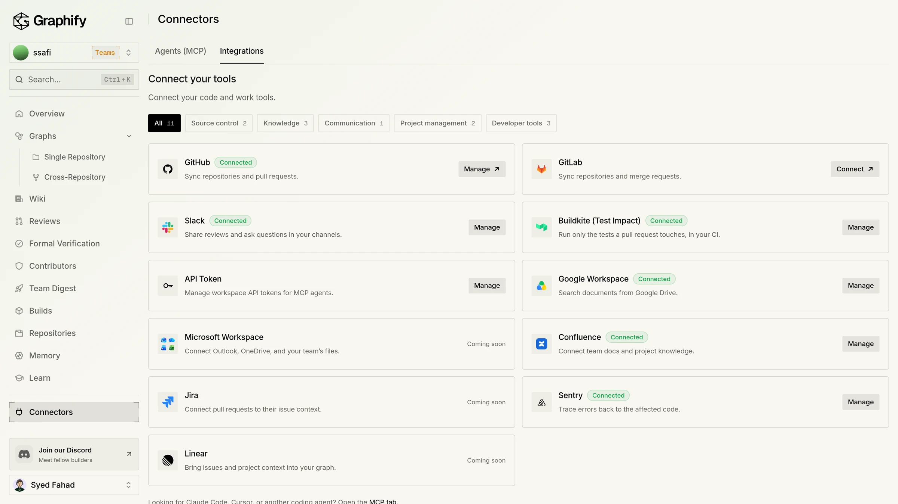
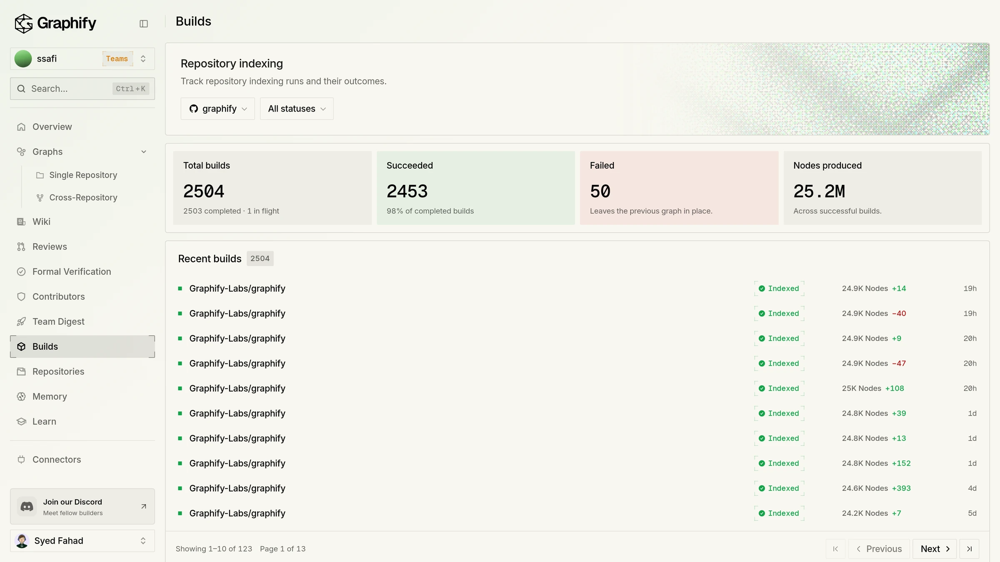
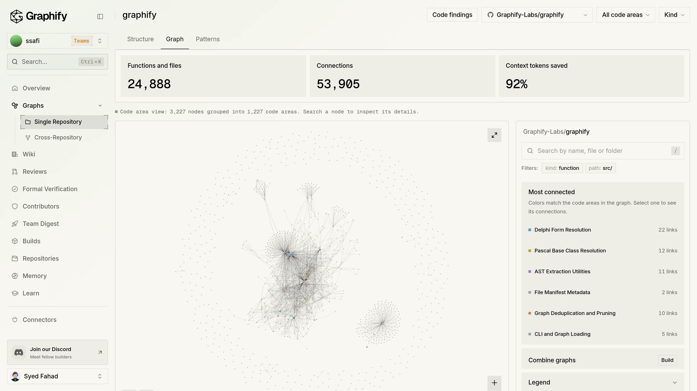
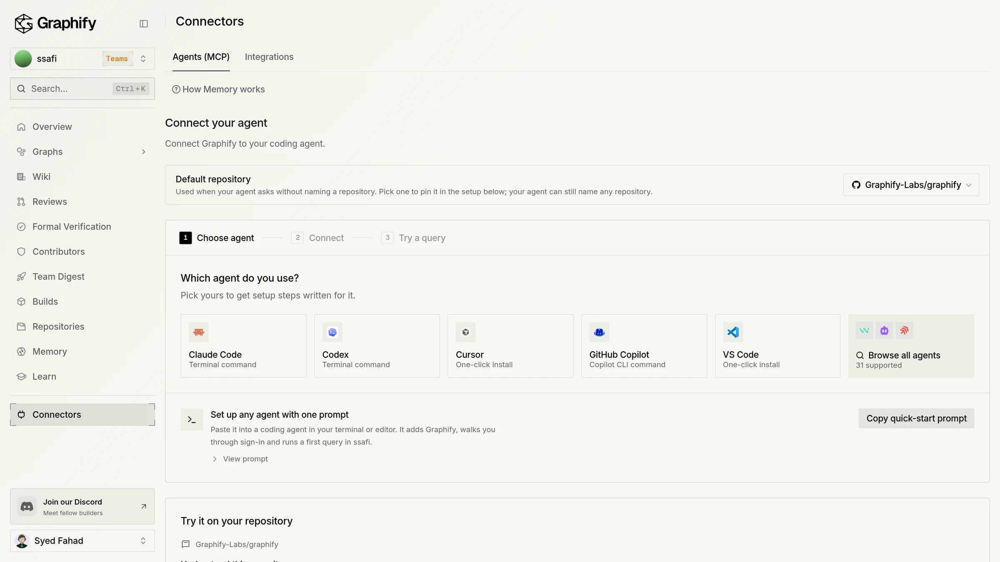

本页带你上手 Graphify，也就是 app.graphify.com 上的托管产品。它由我们替你运行，所以你无需部署任何东西。它会为你的 GitHub 仓库建立索引，为每个仓库构建图谱和 Wiki，并通过托管 MCP 服务器提供给你的编程智能体。你的电脑上也不需要安装任何东西。

你需要一个能访问该仓库的 GitHub 账号，以及一个支持 MCP 的编程智能体。你还需要一个 Graphify 账号。如果还没有，可以在连接时免费创建，或者在下面登录。Free 方案无需绑卡。参见[方案与价格](/platform/support/pricing)。如果你更希望把图谱保留在自己的电脑上，请使用开源版 Graphify（`graphifyy` 包），参考[本地快速开始](/open-source/quickstart)。

<Note>
如果你是智能体，请在执行这些步骤之前先阅读[给智能体的说明](/for-agents)。
</Note>

<Steps>
  <Step title="登录" titleSize="h2">
    打开控制台，也就是位于 [app.graphify.com](https://app.graphify.com?utm_source=docs&utm_medium=link&utm_campaign=platform-quickstart) 的 Web 界面，然后登录。你会进入 **Overview** 页面。它可能会问 **What would you like to do first?** 你可以选一个选项，也可以跳过，因为下面的步骤涵盖了同样的内容。

    
  </Step>
  <Step title="连接 GitHub" titleSize="h2">
    进入 **Repositories**，点击 **Add GitHub repositories**，然后为 Graphify GitHub App 授予你想要的仓库的访问权限。你也可以从 **Connectors → Integrations** 连接。

    已连接的仓库会显示为 **Paused** 和 **Not indexed**。这是正常的，因为在你主动选择之前，不会为任何仓库建立索引。

    
  </Step>
  <Step title="为仓库建立索引" titleSize="h2">
    找到该仓库，打开它的 **…** 菜单，然后打开 **Indexing**。这会把首次构建加入队列。你也可以在 **Overview** 页面点击仓库卡片旁边的 **Index**。

    Free 方案（最多 3 个仓库）无需绑卡。Pro 和 Teams 从 14 天试用开始，需要绑卡。**Pro** 和 **Teams** 不限制仓库数量。在 **Teams** 中，仓库和 Google Drive 来源会共享给工作区里的所有人。可以用侧边栏顶部的切换器切换工作区。参见[方案与价格](/platform/support/pricing)。

    托管版 Graphify 列出了 63 种语法。开源版 Graphify 支持 40 种语言（33 种基于 tree-sitter，7 种内置）。参见[把你的技术栈带到 Graphify](/concepts/bring-your-stack)。

    在 **Builds** 页面跟踪运行进度。完成后，仓库的状态会变为 **Indexed**。

    
  </Step>
  <Step title="查看图谱和 Wiki" titleSize="h2">
    打开 **Graphs**，浏览该仓库的节点及其连接最多的区域。然后打开 **Wiki**，它会自动为仓库的每个区域写一篇文章。**Memory** 让你可以在 Graphify 已知的内容中提问或搜索。想要图谱的引导式讲解，请参见[读懂你的代码图谱并清理仓库](/cookbooks/read-your-graph)。

    
  </Step>
  <Step title="连接你的智能体" titleSize="h2">
    进入 **Connectors → MCP**。向导分三步：**Choose agent**、**Connect** 和 **Try a query**。它会为 Claude Code、Codex、Cursor、GitHub Copilot、VS Code 以及更多智能体生成设置步骤（打开 **Browse all agents** 查看完整列表）。

    想一键完成？可以使用 [Connect Graphify in Claude](https://claude.ai/directory/graphify)（[Claude.ai 和 Desktop](/integrations/claude-ai)、[Claude Code](/integrations/claude-code)）、[Connect to Cursor](cursor://anysphere.cursor-deeplink/mcp/install?name=graphify&config=eyJ1cmwiOiJodHRwczovL2FwaS5ncmFwaGlmeS5jb20vbWNwIn0%3D)、[VS Code 的 Graphify 扩展](https://marketplace.visualstudio.com/items?itemName=graphify-labs.graphify-mcp)，或者[适用于 ChatGPT 和 Codex 的 Graphify 插件](https://chatgpt.com/plugins/plugin_asdk_app_6abe89f7f5d88191b9422522bb8562a4)。它们都连接到同一个托管服务器，并通过 OAuth 登录。

    你也可以自己添加服务器。每个智能体只需要一行命令或一条配置：

    <CodeGroup>
    ```bash Claude Code
    claude mcp add --transport http --scope user graphify https://api.graphify.com/mcp
    ```
    ```bash Codex
    codex mcp add graphify --url https://api.graphify.com/mcp
    codex mcp login graphify
    ```
    ```json VS Code (.vscode/mcp.json)
    {
      "servers": {
        "graphify": { "type": "http", "url": "https://api.graphify.com/mcp" }
      }
    }
    ```
    ```text Any MCP client
    Name: graphify
    URL:  https://api.graphify.com/mcp   (Streamable HTTP)
    ```
    </CodeGroup>

    终端里没有 `claude` 命令？Claude 桌面应用和 IDE 扩展可能不会添加这个命令。请按照 [Claude Code 页面](/integrations/claude-code#no-claude-command-edit-the-config-file)上的 `~/.claude.json` 步骤操作。

    首次连接会打开 OAuth 登录。不需要粘贴 API key。如果你不知道如何配置你的智能体，点击 **Copy quick-start prompt** 并粘贴到智能体中。它会添加 Graphify，引导你完成登录，并运行第一个查询。

在 **Try a query** 上留意连接状态：当有调用到达时，它会显示 **Connected. Graphify just received a tool call from your account.**；如果 Graphify 在过去 30 天内已经收到过你的调用，则显示 **Connected. Last tool call from your account: …**。索引完成后，使用 **Try it on your repository** 下的入门任务，并把规则块复制到智能体的指令文件中。详情与排查：[确认它在正常工作](/platform/verify-connection)。

    

    各智能体的专属指南：[VS Code](/integrations/vscode)、[JetBrains](/integrations/jetbrains)、[ChatGPT](/zh/integrations/chatgpt)、[OpenClaw](/integrations/openclaw)、[Vercel](/integrations/vercel)，以及[其他任意 MCP 客户端](/integrations/other-agents)。
  </Step>
  <Step title="运行第一个任务" titleSize="h2">
    在同一页面的 **Get your first useful result** 下，点击 **Copy first task** 并粘贴到你的智能体中。或者用你自己的话提问：

    ```text
    Using Graphify, explain what this repository does, trace one main entry point, and show the files involved.
    ```

    回答会引用已索引图谱中的源码位置。打开它们进行核对。关于如何解读回答，请参见[解读结果](/platform/read-a-result)。
  </Step>
</Steps>

## 如果出现问题 {#if-something-looks-wrong}

| 现象 | 解决方法 |
| --- | --- |
| 横幅提示 **Your agent is pointed at a different workspace** | 点击横幅上的 **Point my agent at _workspace name_**，或者切换到你的智能体所用的工作区。 |
| 智能体要求提供 API key | 服务器使用 OAuth。检查 URL 是否为 `https://api.graphify.com/mcp`。 |
| 只能看到本地工具 | 这个连接读取的是本地图谱文件。请改为添加上面的托管 URL。托管版的工具列表以你的客户端从 `tools/list` 显示的内容为准。 |
| 智能体说没有仓库 | 等待 **Repositories** 上显示 **Indexed**，或者在 **Connectors → MCP** 中设置默认仓库。 |
| 设置时提示 **This repository has no commits yet, so there is nothing to index.** | 向默认分支推送一次提交，然后选择 **Re-sync repositories**，或者选择其他仓库。 |

要确认你的智能体已连接，并且会优先使用 Graphify 而不是 grep，请参见[检查你的智能体是否在使用 Graphify](/platform/verify-connection)。更多解决方法见[遇到问题时](/platform/support/faqs)。

## 下一步 {#next-steps}

<Columns cols={2}>
  <Card title="追踪一次改动" icon="route" href="/platform/trace">
    跨文件和跨仓库追踪一条关系。
  </Card>
  <Card title="控制台导览" icon="layout-dashboard" href="/platform/console">
    逐一讲解 app.graphify.com 中的每个页面。
  </Card>
  <Card title="审查拉取请求" icon="git-pull-request" href="/platform/reviews">
    每个新的拉取请求都会得到一次跨仓库 PR 审查，发现的问题基于图谱得出。
  </Card>
  <Card title="已经在用本地 Graphify？" icon="laptop" href="/platform/support/move-from-local">
    从本地图谱迁移到 Graphify。
  </Card>
</Columns>
